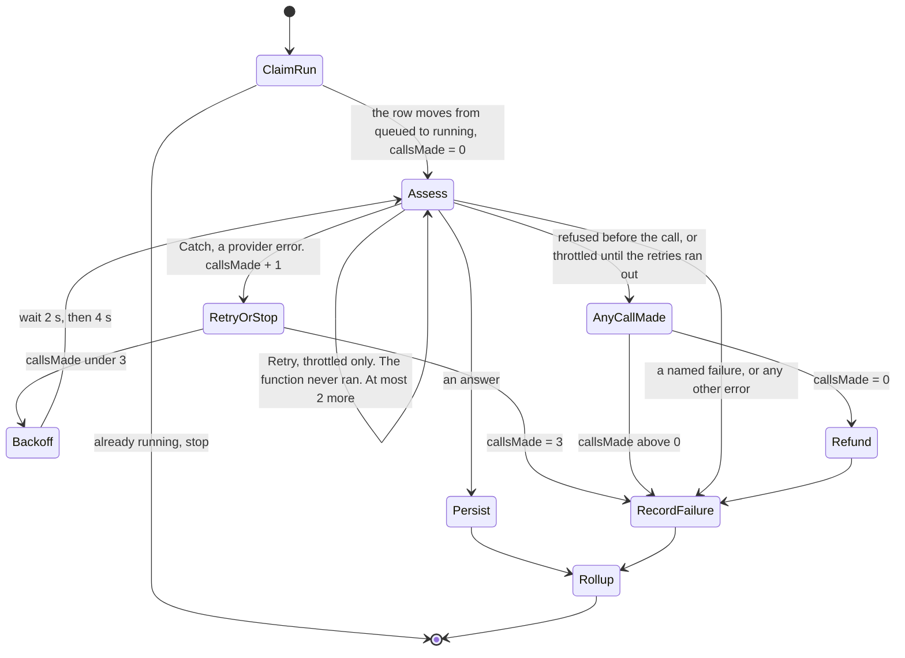

# ADR-0018 — Refund an attempt only when the whole run made no model call

- **Status:** Accepted 2026-10-29, by the owner (gate 84). The rule is the owner's (gate 82)
- **Date:** 2026-10-29
- **Supersedes in part:** [ADR-0014](0014-run-the-assessment-as-a-step-functions-workflow.md),
  the `Retry` on the three provider errors and the arrows into `Refund`.
  [ADR-0016](0016-refund-an-attempt-when-no-call-was-made.md), its table of refund paths. Everything
  else in both records stands, including the rule of ADR-0016 itself.

**What this record decides:** how the workflow knows whether a run called the model, and so whether
it may give the attempt back. **What is still open:** nothing. **What to do
next:** 800 Infra changes the state machine in `01-iac-plan.md`. 500 Engineering and 600 QA update
the retry and refund tests. Seam ledger finding 62 lists the files.

## Context

ADR-0016 says an attempt is refunded only when no model call was made. Gate 82 says the same thing
from the other side: a try counts whenever the model was called, even when the call failed.

ADR-0014 draws one arrow into `Refund`: `assess` refused before the call, because the kill-switch was
off or the circuit breaker was open. Seam ledger finding 58 found a path it missed. `assess` runs one
copy at a time (reserved concurrency 1). When a second run asks for it, Lambda refuses with
`Lambda.TooManyRequestsException`, which Step Functions reports *"when Lambda exceeds the maximum
number of invocations"*. The function never starts, so no model call is made. If that happens on
every try, the retries run out, the run fails, and the person loses a try that bought nothing.

**One more arrow is not enough, because of the retry.** `MaxAttempts: 2` allows up to three tries of
`assess` in one run, and each try can end in a different way. When the retries run out, the `Catch`
receives the error of the last try only. A `Retry` keeps no record of what an earlier try did. Both
facts are from [Step Functions error handling](https://docs.aws.amazon.com/step-functions/latest/dg/concepts-error-handling.html),
checked 2026-10-29. So the last error cannot say whether an earlier try called the model.

This table is a lookup table. Each row is one possible run.

| Try 1 | Try 2 | Try 3 | Model calls | What gate 82 says | What ADR-0014 does |
| --- | --- | --- | --- | --- | --- |
| throttled | throttled | throttled | 0 | give the try back | counts it. This is finding 58 |
| model timeout | throttled | throttled | 1 | count it | counts it. An arrow from the throttle to `Refund` would give it back, which is wrong |
| model timeout | breaker open | — | 1 | count it | **gives it back.** A second fault of the same kind, found in this pass |
| throttled | kill-switch off | — | 0 | give the try back | gives it back. Correct |

**The third row is not rare.** Every failed call counts toward the breaker's five failures
(ADR-0014). So a run whose call just failed is the run most likely to meet an open breaker on its
next try.

## Decision

**The run counts its own model calls, and `Refund` is reached only when that count is 0.**

1. **`ClaimRun` sets a workflow variable, `callsMade`, to 0.** A variable is a named value the
   workflow keeps for the whole run. Step Functions sets one with `Assign`, which a state, a `Choice`
   rule and a `Catch` can all carry
   ([Step Functions variables](https://docs.aws.amazon.com/step-functions/latest/dg/workflow-variables.html),
   checked 2026-10-29).
2. **Throttling keeps its `Retry`.** `Lambda.TooManyRequestsException` means the function did not
   run, so a retry costs no money. `MaxAttempts: 2`, 2 seconds then 4, as before.
3. **The three provider errors move from `Retry` to `Catch`.** `ProviderTimeout`, `ProviderThrottled`
   and `ProviderUnavailable` each mean the request was sent to the model. Their `Catch` adds 1 to
   `callsMade` and goes to `RetryOrStop`.
4. **`RetryOrStop` is the cap.** While `callsMade` is under 3, it goes to `Backoff`, which waits 2
   seconds after the first failed call and 4 seconds after the second, and then runs `Assess` again.
   At 3 it goes to `RecordFailure` with the error's name. So a run still makes at most 3 calls.
5. **Every ending where this try made no call goes through `AnyCallMade`.** Two endings reach it.
   `assess` refused before the call: the kill-switch was off (`feature-off`) or the breaker was open
   (`provider-unavailable`). Or the throttle retries ran out (`provider-unavailable`; the execution
   history keeps the exact error name). `AnyCallMade` sends the run to `Refund` when `callsMade` is
   0, and straight to `RecordFailure` when it is not.
6. **Every other error counts the try.** A task timeout, a crash of the function, or a run that dies
   outside its own `Catch` and is closed by `mark-failed`: none of them refunds. The workflow cannot
   see whether the function reached the call before it died. When it cannot tell, it counts, for
   the reason gate 82 gives: the ten tries a day are the only daily limit on AI spend.
7. **The API's own refund is unchanged.** When `StartExecution` fails, the API refunds before it
   answers (ADR-0016). No workflow ran, so no call was made.

`callsMade` counts the tries that sent a request and then ended in one of the three provider errors.
A try that returns an answer or a named failure ends the run, so it never needs counting. That is
why, at `AnyCallMade`, `callsMade` is the number of calls the whole run made.

## Consequences

- **The rule holds on every row of the table above.** NFR-38 in `06-nfrs.md` checks it by walking
  every path into `Refund`.
- **The cap moves from one line to one `Choice`.** It was `MaxAttempts: 2` on the provider errors. It
  is now "`callsMade` under 3" in `RetryOrStop`. With `maxRetries: 0` in the adapter, a photo still
  costs at most 3 calls, about $0.012. The cap is still declared once, in the workflow, not in code.
- **A paid retry costs two more state transitions**, `RetryOrStop` and `Backoff`. A `Retry` also
  counts as a transition (the error handling page above), so before it cost one. A normal run adds
  none, because `ClaimRun` sets the variable without a new state. At about 30 assessments a month
  this stays far inside the 4,000 free transitions.
- **Throttling can wait longer in the worst case.** Each time `Assess` is entered, a throttle is
  retried at most twice, and `Assess` is entered at most three times. Every one of those retries is
  free. The person's limit is still the waiting screen's 60 seconds.
- **`assess` gets no new permission.** The fact lives in the run, not in the table.
- **One unfair case is left, and it is named.** If the function dies after it started but before it
  sent the request, the try counts although no call was made. The workflow cannot tell this from a
  death after the call. It needs a crash in the first lines of the handler, and counting is the side
  gate 82 chose.
- **Other files still describe the old retry.** Seam ledger finding 62 names them.

## Alternatives considered

- **Add an arrow from the throttle to `Refund`, and change nothing else.** Rejected. It gives the try
  back on the second row of the table, where a call was made.
- **`assess` writes "a call was made" on the assessment row before it calls, and `Refund` becomes a
  conditional write.** It also gives the right answer, and it would even catch the crash case.
  Rejected, because it gives the function that holds the model key write access to every assessment
  row. ADR-0014 limits that function to the key, two `CONFIG` rows and the breaker row on purpose,
  and a wider role would need 900 Security to look again.
- **Remove reserved concurrency 1, so `assess` is never throttled.** Rejected. Concurrency 1 is what
  makes the breaker's half-open test exactly one call. And the account's own concurrency limit can
  still throttle.
- **Never refund a throttled run.** Rejected. It breaks ADR-0016 and gate 82. It also happens in
  normal use: a person taps on two photos, and the second run waits for the first.

## Agent-Readable Summary

> The workflow keeps `callsMade`, the number of model calls this run made, set to 0 in `ClaimRun`.
> Retry only `Lambda.TooManyRequestsException` with a `Retry`, `MaxAttempts: 2`. Handle
> `ProviderTimeout`, `ProviderThrottled` and `ProviderUnavailable` with a `Catch` that adds 1 to
> `callsMade`, and send the run back to `Assess` only while `callsMade` is under 3. Reach `Refund`
> only through `AnyCallMade`, when `callsMade` is 0. Do not put the three provider errors back into
> a `Retry`, because a `Retry` cannot record that a call was made. Do not draw any other arrow into
> `Refund`. Do not give `assess` write access to the assessment row to record calls.
