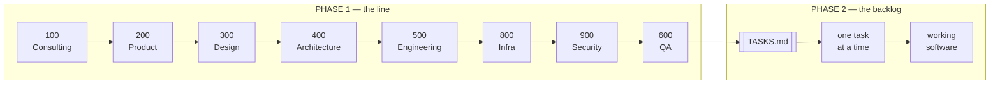
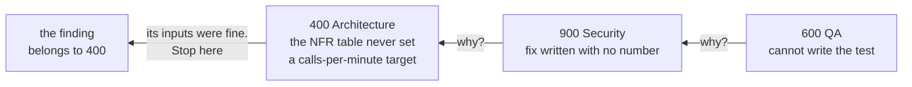

# AI-Native Delivery

**How to build software when AI writes the specifications, the specifications live in git, and every
later session reads them.**

## How to read this

| | What | How to read it |
| --- | --- | --- |
| **Part one**, sections 1–3 | The idea, and the pieces it is made of | Once, in order |
| **Part two**, sections 4–12 | **One real run, from start to finish** | Follow along. Each idea is explained when the run needs it |
| **Section 13** | The glossary | When a word stops you |

Part two tells one real story. It starts with two files on disk and ends with specifications a
developer can build from. The project is **`zamphora`**, a plant-care app for someone whose
houseplants keep dying. The file names, numbers and mistakes are the real ones.

**This note is about the process, not about backend engineering.** When it names a technical idea,
such as a threat model, an NFR or a golden set, that idea is explained in `backend-concepts.md`. The
entries this note uses most are **41** threat modelling, **42** OWASP, **57** SLI and SLO, **58** NFRs
and ADRs, **70** prompt injection and **71** evals.

---

## Contents

**Part one — the idea**

1. [The idea in one page](#1-the-idea-in-one-page)
2. [AI-assisted or AI-native](#2-ai-assisted-or-ai-native)
3. [The seven building blocks](#3-the-seven-building-blocks)

**Part two — one run, from an empty folder to finished specs**

4. [Day zero: what is on disk before anything runs](#4-day-zero-what-is-on-disk-before-anything-runs)
5. [Step 1 — Consulting, and why it gets only two files](#5-step-1--consulting-and-why-it-gets-only-two-files)
6. [Step 2 — Product, and the first handover](#6-step-2--product-and-the-first-handover)
7. [Step 3 — Design turns stories into screens](#7-step-3--design-turns-stories-into-screens)
8. [Step 4 — Architecture, and the first human gate](#8-step-4--architecture-and-the-first-human-gate)
9. [Steps 5 and 6 — Engineering, then Infra](#9-steps-5-and-6--engineering-then-infra)
10. [Steps 7 and 8 — Security, then QA, and the break](#10-steps-7-and-8--security-then-qa-and-the-break)
11. [The run is over: the review is the real output](#11-the-run-is-over-the-review-is-the-real-output)
12. [From specs to code, and the commands you type](#12-from-specs-to-code-and-the-commands-you-type)

**Reference**

13. [Glossary](#13-glossary)

---

## 1. The idea in one page

### The problem

You open the editor, ask the AI for a component, paste it in, and it works. That is fine for one
file. On a real project it fails in a specific way:

- The AI does not know what the project already decided, so it invents an answer.
- The invented answer looks correct, because AI output always looks correct.
- Nobody notices, because nothing was written down to compare it with.
- Next week, a new session knows none of it, so you type the context again.

**A real example.** You ask for a photo assessment feature. No file says how often the answer must be
right, or what to do when the model is unsure. So the AI chooses: a confident verdict every time,
even when it is guessing. Nobody decided that. It happened because no file said otherwise.

### The idea

> **Write the specifications first, with AI, as files in git. Then build the code from those files.**

That is all "AI-native" means. It is not a better prompt or a bigger model. The output of one session
becomes a file that the next session reads.

The short version: **files, not chats, are what you deliver.** If a decision mattered and it is not in
a file, it did not happen.

### The two phases



**How to read it.** It is a flowchart. Read it from left to right. The two halves work in different
ways.

- **Phase 1 is the line.** Eight AI roles run one after another. Each one writes documents, and the
  next one reads them.
- **Phase 2 is the backlog.** A task list is made from those documents. You work on one task at a
  time, and each task points to the spec section it must follow.

**One run** is one pass of all eight roles over **one feature**. It produces the documents, plus a
record of how the run went, in `factory/runs/<name>/`. A product with six features has six runs. You
can also run the same feature again after you fix the setup, and compare the two runs.

**Remember:** the backlog is made from the specs, never the other way round.

---

## 2. AI-assisted or AI-native

### The one question that decides it

Both kinds of team use the same tools. One question separates them:

> **Does the output become a shared file, kept in git?**

| | AI-assisted | AI-native |
| --- | --- | --- |
| Where the prompt lives | In your head | In the repo, in `.claude/skills/` |
| How often it is used | Once | Every session |
| Who reviewed it | Nobody | Reviewed and committed like code |
| Can you measure it | No | Yes, it is a file with a git history |

Three levels describe a team. Installing a tool does not move you up a level.

- **L1:** people use AI in chat, and the output stays in the chat.
- **L2:** some prompts and rules are saved and shared.
- **L3:** every stage of the work has a defined AI step with an expected output file.

**One test works for a team and for one person:** a new developer joins on Friday. Does the whole
setup work for them on Monday, without asking anyone? If yes, it is in files. If they need you to
explain something, it is in your head, and that is L1, whatever tools are installed.

### Seven common mistakes

| Mistake | What it looks like |
| --- | --- |
| **Chat as delivery** | The useful output stayed in the chat window |
| **Keeping files to yourself** | You wrote a good skill and never shared it |
| **One hero** | The setup lives in one person's habits, and leaves with them |
| **Watching the agent all the time** | You watch every step and correct it live |
| **The biggest model by default** | A premium model on a task the normal model can do |
| **Buying tools and waiting** | Buying tools and expecting results. Also: depending on one vendor |
| **A feeling as the measurement** | "It feels faster" is the whole measurement |

The first mistake blocks every other improvement, so fix it first. The last one is why most teams
cannot answer "what did AI really save us?": nobody wrote a number down before they started.

### What it costs

There are two different costs. People mix them up, and then they think this is expensive.

- **Spec cost** is human time, paid once. It is expensive in hours and cheap in money.
- **Run cost** is model calls, paid on every run. **A run with several agents costs about 15 times a
  single chat.** That is fine once, for a real feature. It is not fine three times because nobody read
  the first two.

**A budget is a number that stops something.** "Be careful with cost" stops nothing. Write the limit
into the setup (this project uses 250,000 tokens per role), and say what happens when it is reached:
stop and ask a person.

**Remember:** AI-native is one question. Does the output become a file in git that someone else reads?

---

## 3. The seven building blocks

### The problem

You want the AI to always use `type` instead of `interface`. There are seven places where you could
write that rule, and they behave very differently. In the wrong place, the rule either never loads, or
it loads on every unrelated question and pushes out something you needed.

**The only real difference between them is when the model sees the file.**

| Block | Lives in | Loads | Use it when the rule… |
| --- | --- | --- | --- |
| **Rule file** | `CLAUDE.md`, `AGENTS.md` | Every session, always | Must always be there |
| **Context file** | `docs/` | When a task points to it | Matters only for one kind of work in this repo |
| **Skill** | `skills/<name>/SKILL.md` | When the task matches its `description` | Matters only for one kind of task |
| **Subagent** | `agents/<name>.md` | When it is started, in its own context | Needs so much reading that it would fill your session |
| **Command** | `commands/<name>.md` | When you type `/name` | Is something you type again and again |
| **Hook** | `settings.json` | On an event, as a shell command | Must run automatically on your machine |
| **MCP server** | `.mcp.json` | At session start, giving the agent tools | Needs the agent to *act on* a system outside the repo |

Go down the last column and stop at the first block that works. **Choosing a block that is too wide
is the expensive mistake.** Above all seven there is one more: a rule that must hold on every pull
request, with no exceptions, belongs in a **required CI check**.

### The four that are easy to get wrong

**Rule file.** It loads completely in every session, so keep it short. After a few hundred lines it
stops working well: the model holds all of it at once, so each important line gets less weight. Put
rules and pointers here, and explanations in `docs/`. `AGENTS.md` is 20 lines that say "the rules are
in `CLAUDE.md`", so other AI tools find the same rules. A pointer, never a copy.

**Context file.** This layer does the most work: the stack, the conventions, the specs, the decisions.
There are three layers, by how often they load:

| Layer | Where | Loaded |
| --- | --- | --- |
| **hot** | `CLAUDE.md` | Always. Keep it short |
| **warm** | `docs/` | When it is relevant. The real detail lives here |
| **cold** | `context/cold/gap-log.md` | Rarely. Things that once existed only in a conversation |

The real risk in the warm layer is a document that **no longer matches the code**, not a short one.
Everyone can see that a short document is short, so nobody trusts it too much. An out-of-date
document looks fine, so people trust it. One rule fixes this: **update the context file in the same
pull request that made it wrong.**

**Skill.** A saved way to do one kind of task, such as how to review a branch, or how to find the
cause of a bug before editing. Its `description` line decides when it loads, so the description names
the situation, not the topic.

> **A skill must still work when you copy it into another repository.** No paths, no version numbers,
> no facts about this project.

This is the most common mistake here. A "skill" that contains `apps/web/src/features/plants` is really
a context file. Keep the two apart: a **skill** says *how to do a task*, and it makes sense anywhere. A
**context file** says *what is true here*, and it makes sense only here.

**Hook.** A shell command that runs on an event. It is a script, not the model deciding. **Hooks help.
Required CI checks enforce.** A hook runs on your machine, so it protects only you. A required check on
`main` protects the branch for everyone.

The other three are simpler:

- **Command:** a prompt file you run by typing `/name`. It can run shell commands and put their real
  output in front of the model, so the session starts from the true state.
- **Subagent:** it runs in its own context and gives back only its result. It is good for searching 40
  files. It is bad when you need those files open to edit right after, because you would read
  everything twice.
- **MCP server:** it gives the agent tools instead of text, such as a tracker, a database or a
  browser. Only add one if a role really needs its tools, and say which role may use it.

#### The one MCP server in this repo

`.mcp.json` in the repository root turns on **AWS Knowledge**, a server that AWS runs itself at
`https://knowledge-mcp.global.api.aws`. It needs no key and no AWS sign-in, so it is safe to commit.
It only reads documentation. It never touches the account, and it cannot spend money.

It gives five tools: search the AWS docs, read one doc page, list the Regions, check whether a service
exists in a Region, and read an AWS-written guide.

**Why this repo needs it.** The cost rules are the strictest rules here, and they depend on facts that
change: what the free plan covers, when it ends, which service exists in `eu-central-1`. A model
answers these from memory, and memory goes out of date without warning. These tools return today's
page with its URL, so an infra or security claim can include a link.

**Two limits:**

1. The file only loads when a session starts, and Claude Code asks you to approve the server the first
   time.
2. **The role subagents cannot use it.** Each generated agent has a fixed tool list, such as
   `Read, Write, Glob, Grep, WebSearch, WebFetch` for 800 Infra. An MCP tool that is not on that list
   is not offered. So the tools work in your normal session and in `/ai-factory:next-task`, but not
   inside `/ai-factory:run-role`. To give a role these tools, you edit its slot in the `ai-factory`
   plugin repository, never here.

**Remember:** the only real difference between the seven blocks is when the model sees the file.

---

## 4. Day zero: what is on disk before anything runs

The `docs/` folder is empty. Four files decide everything that follows. You wrote two of them, and
they are in this repository. The other two are not here at all. They come from a plugin.

### The two files you wrote

**`initial-plan.md`** is what you want, in your own words, written before any of this existed:

> I have a problem maintaining my plants at my apartment like my monstera, cactus. The problems are
> the intervals of watering, soil replacement, where to put each plant. Document the state of my
> plants — so a camera, and AI needs to interpret the image to assess my plant. Notifications. i18n.
> Mobile first.

It is messy, and that is fine. It is the only place where your real goal is written.

**`factory/feature.md`** is the one feature this run is about, and, more importantly, what it is
**not** about:

```
The feature: photograph a plant that looks unwell, get back an assessment and a next action.

Out of scope for this run:
  watering-schedule engine · push delivery · sharing a plant · admin screens
  · plant identification · a follow-up chat
```

The "out of scope" list is the limit of the run. When a role tries to make the feature bigger (and one
will), this is the file that stops it. **"Out of scope" means "not in this run", not "never".** The
line runs once per feature, so you edit this file and run again.

Why not all six features at once? Because the useful part of a run is where it stops and asks you.
Eight roles designing six features would give you a review with 200 handovers to check, and nobody
would do it. So run 1 takes the **hardest** feature: a camera, an upload, storage that costs money,
and a model call that can be wrong.

### Run 1 is not like the runs after it

Most of what run 1 writes is not about photos at all. It is the foundation, and later runs read it
instead of deciding it again:

| Written once, in run 1 | Written again for every feature |
| --- | --- |
| Architecture, ADRs, C4 diagrams, patterns | Stories and the PRD |
| Conventions, the stack file | The screens for that feature |
| Environments, CI/CD, cost limits | The contracts and endpoints it adds |
| The design tokens | Its threats and its test cases |

**This table is also the folder rule, and a mistake here gives no error.** A file in the right-hand
column goes into a run folder, such as `docs/200-product/001-photo-assessment/00-prd.md`, numbered so
the runs stay in order. A file in the left-hand column stays in the main folder and is extended. If
you get this wrong, run 2 writes to `docs/200-product/00-prd.md` again and overwrites run 1, and
nothing warns you. One line in `factory/feature.md` gives the run's name (its "slug"), and every
`{feature}` path is built from it.

**So run 2 is much cheaper.** Ask one question about the new feature: **does it change the shape of
the system?** For example: a new data store, a new outside call, a new thing to deploy, or a new
trust boundary.

- **No:** four roles run instead of eight (Product, Design, Engineering, QA).
- **Yes:** all eight run, but Architecture and Infra *extend* their documents.

Write the answer and its reason in the run record. "We skipped Security" is itself a finding if nobody
wrote down why.

### The two files that control the machine

These two files are the whole factory, and everything else is built from them. **Neither is in this
repository.** They live in the `ai-factory` plugin.

**`factory/subagent-registry.yaml` says who exists, and what each role may write.**

```yaml
- id: "900-security"
  owns_folder: docs/900-security/         # the only folder it may touch
  tools: Read, Write, Glob, Grep, WebSearch, WebFetch
  writes: [00-assets.md, 01-threats.md, 02-mitigations.md, 03-evidence.md]
```

**`factory/handoff-map.yaml` says what each role may read, and in what order the roles run.**

```yaml
reads:
  "900-security":
    - docs/400-architecture/02-containers.mmd
    - docs/500-engineering/03-api-spec.md
    - docs/800-infra/01-iac-plan.md
```

Security opens those three files. Not the PRD. Not the design spec. Not this chat.

**To change how the line works, change one of these two files.** Never edit a file that was built from
them.

The same file holds `execution_order`, and two positions surprise people:

- **Infra (800) runs before Security (900)**, because you cannot find the threats of a deployment
  nobody has described yet.
- **QA (600) runs last**, because a real test plan needs the engineering spec, the infra plan and the
  security fixes. A test plan written early only tests the happy path.

### Why the line is a plugin, and the product is not

The line knows nothing about plants. It would run on a banking app without changes. The product is
the opposite: it is only ever this product. The two change for different reasons and at different
times, so they live in different repositories:

| Repository | Holds | Changes when |
| --- | --- | --- |
| `ai-factory` | The roles, the registry, the handoff map, the scripts, the commands | You improve the **method** |
| `zamphora` | `docs/`, `feature.md`, the app, the contracts, the infra | You build the **product** |

`ai-factory` is a Claude Code plugin. One committed line in `.claude/settings.json` turns it on, and
then every command has its name in front: `/ai-factory:start`, not `/start`.

**The split is by reuse, not by front end and back end.** Two repositories for the web app and the API
were considered and rejected, because a coding agent reads one repository at a time. If the API were
somewhere else, the agent changing the web app could not see who calls the code it changes. The cost
would be four to six pull requests for one change that touches both sides.

The plugin gives you two more things:

- **The agents cannot fall behind the contracts they are built from.** You write a slot contract by
  hand, a script turns it into an agent file, and both are in `ai-factory`. So its CI compares them on
  every push.
- **The next project installs the line instead of copying it.** If you copy the folder into a second
  project and then fix a mistake in one role, the second project keeps the mistake. With a plugin, you
  push the fix once, and every project gets it by raising a version number.

### Five things that go wrong when you ship a plugin

A plugin is a folder with a **manifest**: a small JSON file that says what is inside. The folder can
hold any file: YAML, Node scripts, whatever the commands need. Writing it is quick. Making it load is
the slow part. All five mistakes below happened here, and none of the error messages said what was
really wrong.

| The mistake | What to do instead |
| --- | --- |
| You need **two** JSON files, not one | `plugin.json` describes the plugin. `marketplace.json` is the catalog that lists it. Even a repository with one plugin needs the catalog, with `"source": "./"` |
| Naming the default folders in `plugin.json` | The `agents` field expects file paths, so `"agents": "./agents/"` fails with `Invalid input`. Use the normal folder layout and leave those fields out |
| Pushing without checking | `claude plugin validate .` finds both mistakes above in one second. Without it, you get an install error that names a temporary folder |
| The setting is `enabledPlugins`, not `plugins` | Put `extraKnownMarketplaces` next to it, in `.claude/settings.json`, the file you commit. In your personal settings it only works on your machine |
| `${CLAUDE_PLUGIN_ROOT}` only works inside text | Claude Code replaces it in a command, skill or agent file. It does **not** set it for a script that the command starts. A script can find its own folder with `import.meta.url` |

**A running session keeps the plugin version it started with.** If you fix a script, push it and
update the catalog, nothing changes until you run `/reload-plugins`. Also raise the version in
`plugin.json` on every release. The same number means "the same plugin", and it is never downloaded
again.

**One update has three steps:**

1. `claude plugin marketplace update poszet-plugins`, because your machine keeps its own copy of the
   catalog. Without this step, the update says "already up to date".
2. `claude plugin update ai-factory@poszet-plugins`.
3. `/reload-plugins`.

The update changes **one scope**, and the default scope is user. This plugin is installed in both the
user scope and the project scope, so the project copy also needs `--scope project`. `claude plugin
list` shows the version in each scope.

**One thing to keep in mind before the run starts.** The eight roles write about thirty documents, but
the documents are not the main point. **The loop is the main point:** run the line, find the seams and
gates, change the factory, and run again. This will make sense after you see a run break.

---

## 5. Step 1 — Consulting, and why it gets only two files

### What a consultant does

A company that wants something built calls in a consultant. The consultant writes no code. They ask
questions until the problem is clear, they look at what already exists on the market, they write down
the decisions that are already made (so nobody argues about them again), and they hand over a folder.
Someone else builds from that folder.

Role 100 is that person. It gets two files, works once, and hands over four. Everything it knows comes
from reading, asking and searching, never from building.

You type `/ai-factory:run-role 100-consulting`. Your main session does not do the work. It starts the
role as **a new session that remembers nothing**: no chat history, only files. It gives the role the
two files on its `reads:` list, and stops when the role is done.

### The four files, and what each one is for

They are written to `docs/100-consulting/`. Read them in this order:

| File | In one sentence | In real life |
| --- | --- | --- |
| `00-context-brief.md` | Everything everyone "just knows" and nobody wrote down | The notes from the first meeting |
| `01-use-cases.md` | The jobs the app must do, ranked, each one judged | "What do you really need it to do?" |
| `02-decisions.md` | Choices already made, and why, so no later role opens them again | The meeting minutes: agreed this, rejected that |
| `03-market.md` | Products that already exist, their prices, what they do badly | The competitor check |

None of them is a plan or a design. A consultant does not decide what gets built or when it ships.
Those decisions belong to the owner, and to roles 200 and 400.

**The brief has four parts, and each one must be there**, even if the answer is "none known":

| Part | For zamphora |
| --- | --- |
| **Business** | One developer, part-time. The AWS free plan **ends on a written date** |
| **Product** | One person with houseplants in an apartment, on a phone, in two languages |
| **Engineering** | Next.js, Nest.js, shared Zod contracts. Already decided |
| **Regulatory** | A plant photo shows the inside of a home. Personal data from the first file |

If the engineering part is missing, every later role invents its own stack rules.

### `01-use-cases.md` is long, but it does one small thing many times

The file feels heavy because of its size, not its idea. It lists seven jobs, such as: take a photo and
get an assessment, turn the result into a care task, sign in, delete a photo. Then it asks **the same
four questions about each job**:

| The question | What it really asks |
| --- | --- |
| **Value** | Does the user want this enough to use it? |
| **Usability** | Can they do it while standing in front of a plant, with a phone in one hand? |
| **Feasibility** | Can one part-time developer build it? |
| **Viability** | Is it worth *running* afterwards: the money, the attention, the risk of being wrong? |

Seven jobs times four questions is twenty-eight small judgements. That is the whole file.

These four questions come from Marty Cagan's book *Inspired*. A feature can fail on any one of them,
and teams usually check only the third. A job that fails a question is not deleted. It is marked
`open` and handed to a person. For example, UC-5 (how long a photo is kept) stayed `open` on Viability
until the owner chose 180 days.

**To read it in two minutes:** open the ranked list near the top, then read only the four rows of
UC-1. Every other job has the same shape.

### Why it gets only two files: isolation

It would be easy to give role 100 the whole repository. Do not. **Isolation** means a role reads only
the inputs listed for it. The reason is not tidiness. A role that can read everything always finds
something close enough, uses it, and never mentions it. A role that cannot read everything **stops and
tells you that a fact is missing.** That stop is the useful result.

A second rule goes with it. **Single writer:** every file has exactly one role that may create it.
Otherwise the second role overwrites the first, and nobody can say which version was meant.

Giving each role less information sounds wrong. It is the most useful part of the design.

### It may search the web, and most roles may not

Only four roles can search the web, each for one narrow reason:

| Role | May look up | Must not |
| --- | --- | --- |
| 100 Consulting | Products that exist, their prices, what they do badly | Invent a number it could not find a source for |
| 400 Architecture | Standards, RFCs, named patterns | Treat a technology named in an input as already decided |
| 800 Infra | A current cloud price or free-tier amount | Quote a price without the date it was checked |
| 900 Security | A CVE, an OWASP entry, a control definition | Accept an earlier decision without checking it again |

**Every fact from outside carries its source link and the date it was checked.** Anything not checked
is marked as not checked. And research only happens if someone asks for it. To make the line research
something, name **which role**, **what question**, and **which file the answer goes into**.

**Check before you move on:** are all four parts of the brief there? And where a limit has a date,
does the brief **name the date**, or does it only say "cost matters"? A rule with no number cannot be
tested later.

---

## 6. Step 2 — Product, and the first handover

Role 200 starts, and it remembers nothing about role 100's session. It gets four files:

```yaml
"200-product":
  - factory/feature.md
  - docs/100-consulting/00-context-brief.md
  - docs/100-consulting/01-use-cases.md
  - docs/100-consulting/03-market.md
```

### The first handover has a name: a seam

A **seam** is one file that goes from one role to the next. Role 100 gives `00-context-brief.md` to
role 200. That is one seam. There are about 34 in the whole run, all listed in `handoff-map.yaml` under
`edges:`.

**The run almost never breaks inside a role. It breaks at a seam**, when the next role did not get
what it needed. (The word comes from sewing: a seam is where two pieces of cloth are joined, and cloth
usually tears there.)

Later, you give each seam one of five labels:

- **clean:** it had what it needed
- **under-supply:** it got less than it needed
- **over-supply:** it got more than it needed, so the feature grew
- **missing:** the file was not there
- **routing:** the file went to the wrong role

Do not label anything yet. You cannot see most of them until the run is over.

### What Product writes

- `00-prd.md`: one page that says what the product must do, and how success is measured.
- `01-user-stories.md`: stories US-01 to US-NN, each with pass/fail rules.
- `02-traceability.md`: every story, linked to the metric that proves it worked.

Every story uses the **JTBD** (jobs to be done) shape, which puts the **moment** into the requirement:

> When **I notice a leaf turning yellow**, I want **to photograph it and be told what to do**, so I
> can **fix it before the plant dies**.

This tells you that the answer must come fast and be right, because the user is standing in front of
the plant. It is a requirement on the system, not a UI detail.

### Why an AI story needs three extra answers

"The plant is saved" either happened or it did not: you tap, and you check the row. **"The plant has
spider mites" can be wrong while every line of code works.** There is no correct answer to compare it
with, so "done" means nothing until a person writes down what "done" is. An **Eval Card** holds those
three answers, and it goes into the story before anyone builds it.

| The question | The answer in zamphora | If nobody answers it |
| --- | --- | --- |
| **How often must it be right?** | A person agrees with a `likely` verdict **8 times out of 10**, over the first 20 real assessments | You ship on a feeling, and QA has no pass mark |
| **What does it do when it is unsure?** | Show the verdict, say it may be wrong, and say what a better photo looks like. No care task unless the user says yes | The developer of the screen decides alone |
| **What does it do when it cannot tell?** | Show no verdict, show a reason from a fixed list, and allow no task | The model invents a problem instead of saying nothing |

**The right-hand column is the reason for the card.** These three questions get answered either way.
Without the card, the app shows a confident verdict every time, because that is the cheapest thing to
build. That is exactly the failure from section 1.

**No percentage appears anywhere, on purpose.** A confidence number the model writes about itself is
not a measurement. It is the model's opinion of its own answer, with nothing to check it against. You
can count how often a person agrees, so that is the bar. The model says `likely`, `unsure` or
`cannot-tell`.

The PRD also has a **guardrail metric**: a number that must *not* go up while the success number goes
up. More photo uploads is good. The model bill growing with them is what you watch. This run adds a
second guardrail: the share of `cannot-tell` answers. A model that always says "cannot tell" is never
wrong and never useful.

### What the real run showed

Two things that role 200 did here matter more than the 14 stories it wrote.

**It guessed three numbers and refused to guess a fourth.** No file said how long a session lasts, how
fast the kill-switch works, or how long the whole flow may take. So it proposed 30 days, 60 seconds and
30 seconds, and marked each one as needing a person. Then it reached the daily limit of assessments
per user. That limit is the only thing between an open endpoint and an empty balance. It proposed no
number, and it stopped the line. **Guess what costs a rewrite. Never guess what costs money.**

**It broke its own rule inside its own file.** Section 8 of the PRD says the build order is not decided
there. But section 3 gives every feature a run number that is in no input file. The rule was in the
role's contract, and the file broke it anyway. That is why you read the output even when the contract
is good.

**Check before you move on:** does every acceptance rule have a **number**? And does the AI story say
what happens when the model is **unsure**? One vague word here costs three later roles: Design cannot
draw an unsure state, Architecture cannot plan for it, and QA cannot test it.

---

## 7. Step 3 — Design turns stories into screens

Design reads the brief, the PRD and the stories. It writes four files. **The handover is two text
files, never a picture.**

| File | What is in it |
| --- | --- |
| `00-journey-map.md` | The whole path, and where the user feels worst |
| `01-CONTEXT.md` | The feature in one sentence, the hard limits as MUST NOTs, what is excluded |
| `02-SPEC.md` | Every component by its exact name, every screen state, design tokens by name |
| `03-tokens.md` | The names of colours, spacing and type. Never hex values in the spec |

The next role cannot read a picture. It can read a text spec, and a text spec shows up in a pull
request diff.

### The rule that catches the most bugs: count the states

The journey map found something useful: **the worst moment is not taking the photo. It is waiting.**
There are three different waits: resizing, uploading, and the model thinking.

So the camera screen does not have two states. It has **ten**: empty · camera permission denied · no
camera, pick a file · resizing · uploading · assessing · result confident · result unsure · offline ·
failed.

| | |
| --- | --- |
| ✅ | The camera screen lists **10 states**, including "camera permission denied" |
| ❌ | The camera screen shows a photo and a result. That is a demo, not something you can ship |

There is also one rule about what the screen must not do: **the verdict never appears without its
confidence level.** One rule about what a screen must *not* do is worth more than three about what it
should do.

**Check before you move on:** count the states of the main screen. **Fewer than 6 means the spec is not
finished.** Engineering would build one spinner for three different waits, and the unsure state would
silently not exist.

---

## 8. Step 4 — Architecture, and the first human gate

This is the biggest step. Architecture reads the brief, the PRD, the stories and both design files,
and it writes eight things. Seven are described below. The eighth is `05-patterns.md`: the solutions
the system uses again and again, such as the data keys, how sign-in works, how errors are passed on,
and how the counter is protected against races. An ADR says *why* one thing was chosen. A pattern
says *how the same problem is solved every time*, so nobody invents a second way in task 40.

### Options before diagrams

First comes `00-options.md`: **three options that really differ**, such as serverless against
containers, or one table against a relational database. Each is scored on at least three limits, and
the limits pull against each other. If you draw a diagram before the choice is made, you get attached
to your first idea.

**A close score goes to a person.** In run 1, the winner beat the second option 16 to 15. One point is
not enough to defend a choice. So the role took the winner, wrote down the one trade-off between them,
and gave the choice to the owner as a human gate. A role that breaks its own tie in silence has decided
what gets built.

For zamphora, serverless wins, and **the reason it wins matters.** The deciding limit came from role
100's brief: the free account plan. A limit written in step 1 chose the architecture in step 4. That is
the line working as it should.

### C4: two diagrams, and why only two

**C4** shows the same system at four zoom levels: **context, containers, components, code.** You draw
the first two and stop.

| Level | Name | One box is | Drawn here? |
| --- | --- | --- | --- |
| 1 | Context | The product as **one box**, with the people who use it and the outside services it calls around it | Yes: `01-context.mmd` |
| 2 | Containers | The product split into the parts it is built from: the website (`web`), the server (`api`), the database (`table`), the photo store. The test for a box: can you deploy and restart it on its own? | Yes: `02-containers.mmd` |
| 3 | Components | A module or class inside one of those parts | No |
| 4 | Code | The classes themselves | No |

**Levels 3 and 4 are the code, and the code already describes itself.** A drawing of it is out of date
within a week, and nobody notices. Levels 1 and 2 show what the code never says.

**"Container" here has nothing to do with Docker.** If a part can be started, stopped and deployed by
itself, it is a level-2 box. If it belongs to someone else and you only call it, it is an outside box
on level 1.

In run 1, level 1 has **6 boxes**: the plant keeper, the admin, zamphora itself, Cognito, the Anthropic
API and email delivery. Level 2 opens zamphora into **seven parts**: `edge`, `web`, `api`, `llm
adapter`, `contracts`, `table`, `photos`.

Both diagrams are **Mermaid** files: diagrams written as text, in the repo, so an agent can read and
update them. **The bug this catches is a missing arrow.** In run 1, `02-containers.mmd` had a `web` box
whose description said it "fetches every value from the api", but no arrow went from `web` to `api`.
Every box had at least one arrow, so a quick check passed it. The missing arrow hid a question nobody
had decided: does the browser call the API, or does a server call it and pass the cookie on? **Check
that every arrow the text describes is really drawn, not only that no box is alone.**

### ADR or NFR: two things people mix up

| | Is a… | Example |
| --- | --- | --- |
| **ADR** | *decision* | "We use DynamoDB with a single table" |
| **NFR** | *target* | "The result is on screen within 30 seconds, 95% of the time" |

They are in different files on purpose. **Every ADR ends with an Agent-Readable Summary**: a plain
instruction with an explicit "do not". For example: *"All model calls go through `LlmProvider`. Do not
import the Anthropic SDK outside `packages/llm/src/adapters/`."* Without it, an agent reads the whole
ADR, agrees with it, and still writes the import, because nobody said what to *do*. Once an ADR is
accepted, **nobody edits it**. A new ADR replaces it, and both stay, so the history survives.

### A number only counts if it has three links

> a written number → an automatic test that checks it → that test blocks a release if it fails

If one link is missing, the number is only a wish. `06-nfrs.md` is a table where every row has all
three:

| NFR | Target | How it is checked | Which CI job runs it |
| --- | --- | --- | --- |
| NFR-01 how long the user waits | **p95 under 30,000 ms** | Playwright runs the whole flow on a slow connection, with the model replaced by a stub that waits 8,000 ms | `perf-flow` |
| NFR-10 what one assessment costs | **≤ $0.0040 per call, ≤ $0.012 per photo** on Haiku 4.5, because one photo may need three calls | The cost is read from the `usage` block the API returns, never estimated, and compared with the published prices | `test` |
| NFR-20 how often the verdict is right | **≥ 8 out of 10**, provisional | Run 40 known photos through the real model and count how often a person agrees | `ai-eval` |

Three things in that table are easy to miss:

- **Cost can be a unit test.** You do not call the model. You take the prompt, count its tokens,
  multiply by the published price, and check that the result is under the limit. If someone adds three
  paragraphs to the prompt later, this test fails on the pull request, before any bill arrives.
- **The 40 photos are a golden set:** real photos where a person already wrote down the right verdict.
  It is the only honest way to test an AI feature, because there is no "correct output" to compare a
  string with, only "right often enough".
- **The last column is a GitHub Actions job name.** `test` runs on every pull request. `ai-eval` costs
  real money: 40 photos at $0.0040 is $0.16 per run, so every night would be about $4.80 a month
  against a $5 balance. So it runs only when someone starts it. It still **blocks the release**, which
  is the third link.

A normal project does not have the last two rows. **An AI feature needs a cost-per-call number and a
how-often-is-it-right number**, both decided at design time.

### The timed flow: the numbers must add up

`001-photo-assessment/03-flow.md` lists every step of the flow with a time, in two columns: the normal
run, and the slowest run the design must still survive. The first version looked like this:

```
typical   8,191 ms   warm function, decent signal
budget   15,245 ms   cold function, weak signal, first call of the day
                     against a 30,000 ms promise
```

**The point is that the numbers must add up.** It takes ten seconds to check, and it catches designs
nobody added up. One published example claimed 87 ms when its own steps added up to 92.

The first table also had a third row: a retry, at 25,230 ms. The owner removed the retry, because the
pre-mortem showed it broke the cost limit. **The table made that visible.** The retry did not look
wrong until someone put it next to the limit it had to fit under.

### The budget must also fit under the platform's limit

This was the biggest finding of run 1. It was hard to see because both numbers were the same. The
owner promised the user 30 seconds. An API Gateway HTTP API **cuts off every request at 30 seconds, and
nobody can raise that limit.** When it fires, the person sees a 504 that no part of the product wrote.

The first fix was three deadlines in order, each one a constant in the code:

| Layer | Deadline | What the user sees if it fires |
| --- | --- | --- |
| The application | 20,000 ms | Its own error message |
| The function | 22,000 ms | Nothing. It is only a safety limit |
| The gateway | 30,000 ms | A 504 nobody wrote. Must never be reached |

**A target number is not finished until you check it against the platform's own limit.** Ask this
about every budget: what cuts it off first, and who writes the message when that happens?

**Plan for the worst run the design allows, not for the expected run.** The first check used the
expected run and found 4,770 ms of spare time. Checked against the run the design *permits*, the spare
time was 480 ms. And the cold start had been counted inside the app's own deadline. But the code that
starts that clock cannot run until the cold start is over. **Anything that happens before your code
runs must be planned outside your deadline.**

**Later, this whole shape was replaced.** The owner moved the model call out of the request and into a
background workflow. Now the gateway's 30 seconds is no longer on the paid path, and a retry is allowed
again, with a limit of two (`aws-and-the-pipeline.md` §4). The lesson still holds: the timed table is
what showed that the phone waiting for the model was the real problem. **A finding does not tie you to
the design in which you found it.**

Then choose the shape of the AI part: **plain code (if / else) → one AI call → a fixed chain of AI
calls → a free agent.** Stop at the first one that does the job. Photo assessment is **one AI call**.
Choosing an agent by default is the most common mistake today, and an agent is the hardest thing to
test, debug and predict the cost of.

### The pre-mortem: a fresh session looks for problems

Last comes `07-adversarial.md`, a **pre-mortem**. A brand-new session, which never saw the design being
built, gets one question: "this failed badly — why?" The session that built the design will defend it,
just as a person defends their own work. A new session has nothing to defend.

**In run 1, it found three real defects** in documents that had already been checked by hand:

- The most common read in the product cannot be done in one call, because the key it needs is inside
  the item it has not read yet.
- The spare time in the timed flow was measured on the friendly run, not on the run the design allows.
- One requirement limits the cost of an assessment, and a second attempt, allowed by the requirement
  next to it, goes over that limit.

**Run the pre-mortem before the next role reads those files, not after.** Once a wrong document has
been read, the mistake spreads.

### And here the line stops: a human gate

Halfway through, role 400 stops and asks you: *"How long do we keep a user's photos? I need it to plan
the storage."* Nobody ever decided this. It is not in any file, so the role stops.

**This is a human gate: a question the AI is not allowed to answer, even if it could guess well.**

Why not? A photo of someone's living room is personal data. Choose 30 days, and you may break a law.
Choose 10 years, and you keep something you should not keep. **It looks like a technical question, but
it is a legal one, and the AI cannot see that.** So it must not choose. The roles write. **You choose.**

You do not need to remember which questions are gates. `handoff-map.yaml` lists them under
`human_gate_policy`: accepting a risk, changing scope beyond `feature.md`, asking for secrets or
production data, a policy, compliance, budget or release decision, spending money, deploying, a new
tool the model may call, or going against an accepted ADR. Write every gate into
`factory/runs/<name>/human-gates.md`. Four things can happen:

| What happened | Name |
| --- | --- |
| It asked, you were away, so it went on and wrote "assuming 90 days — **not confirmed by a human**" | `recorded-open` |
| It stopped and waited. Nothing else was written until you answered | `hard-stop` |
| You answered, and the answer is now in a file a role can read | `closed` |
| **It never asked.** It wrote "photos are kept 30 days" as if it were a known fact | `missed` |

The first three are fine. **Watch for `missed`**, because nothing warns you. The document looks
finished, the number looks agreed, and someone took a decision away from you without asking.

### Your answer must end up in a file

You decide: 180 days. You type it in the chat. The run goes on, and it feels done. It is not. **The
next role starts in a fresh session and cannot see your chat.** Tomorrow the conversation is gone, and
your decision is gone with it.

So write it into a file that a role reads, here `factory/feature.md`. Then, in `human-gates.md`, write
**which file you wrote it into, and which role reads it next.** That note is the **return path**: proof
that your answer went back into the line and did not stay in a chat.

**Check before you move on:** do the milliseconds add up? Does every ADR end with a **"do not"** line?
Does every NFR row **name the test** that checks it? A row with "TBD" in the test column gives QA a
number it cannot check, so the number means nothing.

---

## 9. Steps 5 and 6 — Engineering, then Infra

### Engineering writes the contract that both sides import

Engineering reads the stories, the design spec, the architecture options, the container diagram, the
NFR table and every ADR. It writes five files:

- `00-conventions.md`: naming, folders, what is banned
- `01-contracts.md`: the shared data shapes
- `02-web-spec.md`: the web app
- `03-api-spec.md`: every endpoint, its body and its errors
- `docs/context/stack.md`: the stack in one place

**`01-contracts.md` is the most important one.** It holds the Zod schemas, and it is the only place
where a type that crosses the network is defined. The API imports it to check what it sends. The web
app imports it to check what it receives. There is one file, so the two sides cannot drift apart.

**Follow one word to see why this matters.** Product decided what happens when the model is `unsure`.
That decision travels through four roles:

| Role | What it did with `unsure` |
| --- | --- |
| **200** Product | Wrote the rule: on `unsure`, show the verdict, say it may be wrong, create no task without a yes |
| **300** Design | Drew the screen for it: the unsure state |
| **500** Engineering | Made `confidence` a field with three allowed values (`likely`, `unsure`, `cannot-tell`) in a Zod schema in `packages/contracts` |
| **600** QA | Wrote a test that sends an `unsure` answer and checks that the unsure state appears |

The schema step holds it together. Without it, the API allows three values, and the web app checks for
a word someone typed from memory. The first time the two disagree, a user sees a confident wrong
verdict, and nothing warns you.

### The four layers, and the test that keeps them clean

The API is split into four layers. Imports go in one direction only: inwards, towards the rules.

| Layer | Holds | Never holds |
| --- | --- | --- |
| `domain` | The rules, such as "on `unsure`, create no task" | Any import at all |
| `application` | The steps, in order | Which database is used |
| `infrastructure` | The database client and the model adapter | Any rule |
| `presentation` | Controllers and HTTP | Anything worth testing on its own |

**The test for a wrong place: can you check this piece without starting the framework?** If "on
`unsure`, create no task" were in `presentation`, you would need a fake HTTP request to test it. The
most important rule in the product would be the hardest one to test. In `domain`, the test is a plain
function call.

A layer table is real only if a **lint rule** blocks the imports it forbids. A border that nothing
checks breaks as soon as someone is in a hurry.

**A lesson from run 1.** Engineering got a reading list that pointed to a folder that had been
renamed, so it could not open a file that four ADRs refer to. It did not stop. It wrote a confident
spec that was wrong in four places. **A missing input does not show in the output.** You find it by
checking the reading list, not by reading the result.

**Check before you move on:** is `confidence` in the **contract schema**, or only described in the API
spec? If only the API spec has it, the web app invents its own type, and the unsure state never shows.

### Infra: cost is a question of correctness, not of money

Infra answers four questions. A plan that skips one is not a plan:

- **What exactly ships?**
- **How is the deployment written as code?** Never a click in the console.
- **Which pipeline checks stop a bad change before a customer sees it?**
- **What is the one-step rollback?** Named, and tested.

One fact about the AWS free account plan changes how cost is treated. **It cannot send you a surprise
bill. It closes the account instead**, and every resource goes with it. So a runaway cost is not a
money problem. It deletes your work. That is why cost is checked here like any other correctness rule.

Defaults that cost money by themselves:

| Trap | Cost | Instead |
| --- | --- | --- |
| DynamoDB **on demand** (the default) | Billed from the first request | Provisioned. The free amount covers only this |
| A **NAT Gateway** | About $32 a month with no traffic | Never create one |
| **Secrets Manager** | $0.40 per secret per month | Parameter Store `SecureString`, which is free |
| A **KMS key you create yourself** | $1 a month, forever | AWS-managed keys, which are free |

`02-cost-guardrails.md` turns this into numbers that stop things: 10 assessments per user per day, a
budget alarm at 50%, a kill-switch at 100%. The owner chose the 10, not a role.

**Check before you move on:** provisioned, not on demand? No NAT Gateway? A plan that took the default
setting for the table has already chosen the billed mode.

`aws-and-the-pipeline.md` explains the whole running system that comes out of this step.

---

## 10. Steps 7 and 8 — Security, then QA, and the break

### Security reviews a system that now exists

Security runs after Infra for one reason. It reads the container diagram, the contracts, the API spec,
the environments file and the infrastructure plan: **a described system, not an intention.** A threat
model of a deployment that nobody has described yet is only guessing.

It writes `00-assets.md`, `01-threats.md`, `02-mitigations.md` and `03-evidence.md`. It uses **two**
threat lists, because there are two different things to protect:

| List | Protects | The risk it covers |
| --- | --- | --- |
| **OWASP LLM Top 10** | The product: one model call that reads a photo | The model acts on text it did not write |
| **OWASP Agentic Top 10** | The factory: eight roles with tools, web access and permission to write files | A role has memory, tools and the power to act. A single call has none of these |

People forget the second list. **The factory itself can be attacked.** Role 100 fetches web pages and
writes files. A page it reads could contain text that tells it to write something else.

**The test to remember is the lethal trifecta.** Any two of these together are usually safe. All three
at once are dangerous:

> private data · untrusted outside content · a way to send data out

In zamphora, it finds three real risks:

- The photo contains **EXIF GPS** data, which is the user's home address.
- A plant nickname is free text that reaches the model, so it is a **prompt injection** path.
- The paid endpoint is a **denial-of-wallet** target: an attack that breaks nothing and only spends
  your money until the account closes.

One more habit: **check that a package really exists before you add it.** Models invent package names
that sound right, the same invented name comes back in other sessions, and attackers register that
name and wait. This is called **slopsquatting**.

### What the real security run showed

**It produced eight gates and eight seam findings, and that is a good result.** Eight questions it
refused to answer, because they belong to a person, such as a retention period or whether to spend
money. And eight facts it needed that no input file had.

**Three risks were scored Critical because a fact was unknown, not because the design was wrong.** The
clearest example: the role had to review how the build reaches AWS, but `04-ci-cd.md` was not on its
reading list. So it scored the risk at the top, and wrote in the same row that the score is high only
because it could not check, and that it will drop once someone reads that file. Someone read the file
two weeks later. Two of the three properties held, and the score dropped from 15 to 10.

That is the behaviour you want, and it is still a defect in the line. **A role that cannot check
something must say so loudly, and the map should not have put it in that position.** The fix is one
line in `handoff-map.yaml`, written down as a change to the factory. **The general rule: for every
instruction in a role's contract, check that one of its inputs can answer it.** Three separate findings
in this run had this shape.

**The lethal trifecta also fired on the role itself, and the role wrote that down.** It could read the
whole repository, it fetched eight outside pages, and a fetched URL can send data out. Nothing was sent,
and every URL came from a search result it chose. But a risk that fires and is not recorded is the same
as a risk nobody checked, so it is in the record with the reasoning.

**The package check found nothing wrong, and running it was still right.** Every package named in a
spec was looked up in the npm registry. All four were real. You cannot know that in advance.

**Web access paid off.** A CVE published two months earlier and an RFC published one month earlier
both changed the output. A security review written only from the model's memory would have missed
both, and would still have sounded confident.

### A copied control can look the same and do less

**This one was found by reading the documents against each other, not by a test.**

The product must delete an account that has not been used for twelve months. The repository already
had a good pattern for deleting on a schedule: an **S3 lifecycle rule** deletes the photos, so S3 does
the work, and it keeps working even when the app is broken. The security document copied that pattern
and proposed the closest thing in DynamoDB: a **time-to-live** on the profile row.

It sounds right. Both mean "let the store do the deleting". **But they do not do the same amount of
work.**

- An S3 lifecycle rule can delete every object under a prefix.
- A DynamoDB time-to-live deletes **one item**.

So it would delete the profile row, and leave the pots, the assessments, the photos and the sign-in
account behind, owned by an id that no longer exists. That is worse than deleting nothing, because it
looks done.

**The lesson: when you reuse a pattern, check what the mechanism really does, not what the sentence
about it says.** The words matched. The behaviour did not.

### The break: each document is good, and the gap is between them

In this run, three files each wrote one part of the same behaviour, and each part is correct. The
behaviour uses a `requestId`, which is an **idempotency key** (`backend-concepts.md` entry 22). The
phone sends it so that one tap is charged only once.

> `02-web-spec.md` §4.2 — the browser creates a new `requestId` **only when a new photo is picked**.
> US-09 — after a failure, the person sends **the same photo** again.
> `03-api-spec.md` §4a — a repeated `requestId` gets **the same run** back, and a failed run keeps
> its id.

Read one at a time, all three pass a review. Put together, the "try again" button sends the same id,
the API returns the run that already failed, and nothing happens for the ten minutes the API remembers
the id.

QA reported this and wrote **no** test case for it, which is correct: you do not test a behaviour that
nobody has decided yet. The owner then decided: a new id only after the API has answered with a
failure, and the same id again when no answer came back at all.

No single file is broken. The mistake is in what passed between them, and reading any one file will
never show it. This is the seam problem in one example, and it is why the real output of the run is the
review in section 11, not the folders.

**QA is the only role that reads every role before it.** Its input list has 14 files, more than any
other role. The pre-mortem in section 8 looks at one role, so it cannot find a defect like this one. A
mistake that lives between three files needs a reader who holds all three, and on this line that
reader comes last.

### What QA writes

- `00-test-plan.md`: what is in scope, what is out of scope **and why**, the top 3 risks, and the rules
  for starting and finishing testing.
- `01-test-cases.md`: the cases.
- `02-ai-evals.md`: the golden set, the grading rules and the pass bar.

Three parts have no equal on a normal project:

- **At least five negative tests are required.** "Write tests for this" gives you tests that pass,
  because that is what the words ask for. The useful half is the failures: a photo of a wall, a model
  reply that breaks the schema, a model timeout. The real run wrote 117 cases, and **71 of them are
  negative**.
- **Check the grader, not only the model.** The golden set is 40 photos with a known correct verdict,
  and the pass bar is 8 out of 10, from the NFR table. If a model grades the answers, also grade a
  sample by hand, and write down how often the two agree. Otherwise the pass bar measures the grader.
- **A check that costs money can never be a merge check.** The accuracy run calls a paid model 40
  times, so it cannot run on every pull request. It goes on a separate **release check** list. Whether
  it is required before a deploy is the owner's decision, not QA's. The wrong move is to call a check
  critical and leave it optional, which is the same as not having it.

---

## 11. The run is over: the review is the real output

Eight folders. About thirty documents. It looks finished. **It is not.** The folders are not the
output. The value of the run is the twenty-minute review that comes next.

### Walk every seam

A **seam** is one file that one role writes and a later role reads. For example, Product writes
`00-prd.md`, and Design reads it. All seams are listed in `handoff-map.yaml` under `edges:`. An "edge"
in that file is the same thing as a seam.

- **When:** right after each role finishes. Look at each file the role got from an earlier role, and
  write one row: did it get what it needed? At the end of the run, you only check these rows.
- **Who:** you. An AI can draft the table, but **you choose the labels**. Only you know what you really
  wanted, and an AI that checks its own documents calls almost everything clean.
- **How:** type `/ai-factory:factory-run`, then go down the `edges:` list and ask one question for each
  line:

> Did the role on the right get what it needed from this file?

Write one row per seam into `factory/runs/<name>/seam-ledger.md`. Most rows will say clean. **You are
looking for the few that do not.**

### Why the first seams are almost always `under-supply`

After run 1, the top rows of the ledger look bad: six in a row, all `under-supply`. That is not six
different faults.

Role 100 runs first, so its only input is the two files a person wrote by hand. Nothing was missing,
sent to the wrong role or too long, so `under-supply` is the only label left. It tells you one thing:
**the hand-written input is the weakest part of the run, and no role can repair it.**

### A finding names a file and a fact

- ✅ "600-qa under-supplied by the handoff map on `docs/300-design/03-tokens.md`. The file is not in
  its inputs, and `02-SPEC.md` has no hex values on purpose, so the 3:1 focus ring and the 44 px touch
  target could not be checked as numbers."
- ❌ "The roles should communicate better."

The first one names the line you must change. The second one will still be true after the next run.

### Walk backwards: the role that noticed is rarely the role that caused it

You found the rate-limit problem at QA. Do not fix it at QA. Ask one question, again and again:

> **Why did that role write it this way? What did it have to work with?**

Open that role's `reads:` list. If its inputs were fine, the fault is its own. If its inputs were also
thin, go back one more role.



**How to read it.** Each box is one role, and each arrow is a **seam**, the handover where a fact went
missing. Read from right to left, asking "why?" at each arrow. Security had nothing specific to work
with. Architecture had everything it needed and still left the target out, so **the finding belongs to
Architecture.** If you fix it at QA instead, you invent a number on the spot, and from then on that
number looks agreed.

### Gate or seam? They look the same, and you must not answer one of them

A role stops and asks you something. Gates and seams look the same from your side, but they need
opposite reactions. Ask one question:

> **Was answering this some other role's job?**

- Role 500 asks *"what is the rate limit?"* **Yes.** Role 400 owns the NFR numbers and left this one
  empty. That is a **seam**. Do not answer. Fix the Architecture file, and then let 500 read it.
- Role 900 asks *"how long may we keep photos?"* **No.** No role in the line owns that answer. That is
  a **gate**. Answer it. It was always your decision.

The role that asks tells you nothing. What tells you is whether some **other** role should have given
it that fact.

**When it is a seam, it is very tempting to just answer.** You know the rate limit. Typing it takes
five seconds, and then everything looks fine: Security writes a good document, QA writes a good test,
every seam says clean. But `06-nfrs.md` is still empty, so the same thing happens in the next run.
Instead: write **under-supply at 400 Architecture** in the ledger, let the run stop, and put the number
into `06-nfrs.md` before the next run.

**Two exceptions.**

- **Role 100 is different.** It runs first, so **you are its input.** When it asks something only you
  know, answer.
- If role 400 itself asks for the rate limit, it is avoiding its own job. Do not answer. Add a line to
  its contract.

This split is not "important against unimportant". `factory/subagent-slots/400-architecture.md` lists
what that role may **not** decide, and a rate-limit number is not on that list. A question is either on
a list or not, and the lists are written down.

### What a review finds

Three findings of the kind `factory/runs/001-photo-assessment/seam-ledger.md` is full of:

1. **100 → 400, under-supply.** The brief said "cost matters" but never named the date the free plan
   ends, so the options table scored cost without a deadline. The gap travelled through three roles
   before it did any damage.
2. **900 → 600, under-supply.** The rate-limit fix had no number. Traced back to Architecture.
3. **300 → 500, clean but late.** The offline state appeared in the design spec, but no story mentioned
   offline. It entered the scope without passing Product.

And two gates. One is **recorded-open**: whether the EU AI Act applies, still waiting for you. One is
**missed**: Architecture decided what the app does on `cannot-tell` as if it were a technical value,
but Product already owned that decision. **The missed gate is the most valuable finding of the run.**
No amount of re-reading the documents would have found it.

### Then fix the factory, not only the one document

Architecture left the rate-limit number out. You could open `06-nfrs.md`, type the number, and move
on.

**Do not stop there.** In the next run, on the next feature, Architecture leaves out a *different*
number. You fixed one document, but not the thing that writes the documents. So change the factory,
with one line in `factory/subagent-slots/400-architecture.md`:

> ❌ DON'T — ship an NFR row with no number in it

Now this mistake cannot happen again, on any feature. That closes the loop from section 4: run the line
→ find the seams and gates → one change that names one file → you approve it → edit the factory → the
next run shows whether it worked.

Two things make a change like this real:

- **It names the file it edits.** "Improve the security prompt" is not something anyone can do. "Add a
  DON'T row to `factory/subagent-slots/900-security.md` that forbids a fix with no number" is.
- **You do not know yet whether it worked.** Only the next run tells you. That is why `run-record.md`
  has a column called "Did the next run fix it?".

### The reading cost: a file nobody can check is not finished

With AI, writing a document is cheap, and reading it is not. In run 1, the QA role wrote 1,272 lines.
They were correct, and the owner could not check them. People still trust a spec nobody checked, so
its mistakes reach the code. In 2025, Stanford and BetterUp gave this a name: **workslop**, AI text
that looks finished but moves the real work to the reader.

What research says about reading:

- People read about **20% of the words** on a web page (Nielsen Norman Group). So the main point must
  be on the first screen.
- Plain-language guides aim for **15–20 words per sentence** on average.

What the line does about it. All three parts are in the shared "How to write" block in
`scripts/derive-agents.mjs` in the plugin, so every role gets them:

1. **A rule.** B1 English. The first screen of each file says what is decided, what is open and what
   to do next. A lookup table says that it is a lookup table, so nobody reads it from top to bottom.
2. **Three examples, before and after.** Anthropic's prompting guide says examples are one of the most
   reliable ways to control the tone of the output. Each example shows a different fix: a long
   sentence split into two, fragments made into full sentences, a metaphor replaced by the plain fact.
3. **A length instruction, not a word limit.** The roles run on a model that writes longer files than
   older models, so the length must be asked for in the prompt.

**The option that lost: a hard word limit, checked by a script.** It is easy to measure, but it pushes
the model to shrink the text until the sentences break. That happened once in this project: a pass
turned readable text into short fragments, and every file was restored from git.

**The trap: simpler sentences do not reduce the amount.** After the rewrite, the QA files are still
about 14,000 words, an hour of reading. Most of that is the table of test cases, which is for looking
things up, not for reading.

### When is a run finished?

Not when the eight folders look full. A run is finished when it has:

- **at least 3 seam findings**, each naming a file and a fact
- **at least 2 gates** written down
- **at least 1 change to the factory**, naming the file it edits
- one row per role, with the model used and why

This list sounds backwards, so read it again: **a run with no problems in it has failed.** If every
seam says clean, it usually means you answered each question as it came. Nothing stopped, nothing was
written down, and you paid for eight role calls to get eight folders you could have written yourself.

**A run that stopped twice and wrote down why is the good run.**

---

## 12. From specs to code, and the commands you type

### Phase two works differently

The run is over. The documents become `TASKS.md`, and you switch from `/ai-factory:run-role` to
`/ai-factory:next-task`: one task at a time, until there is working software. Every task points to the
spec section it must follow. A task that cannot name its spec section is a task nobody agreed to.

### The folders

There are two repositories, because the line can be reused and the product cannot.

```
ai-factory/                       the line, shipped as a Claude Code plugin
├── .claude-plugin/               plugin.json + marketplace.json (the catalog)
├── agents/                       the role adapters — generated, never edited by hand
├── commands/                     start, learn, factory-run, run-role, next-task, spec-check
├── skills/                       method skills: adr-writer, code-review, root-cause, tasks
├── hooks/                        one script that runs before a code review
├── factory/
│   ├── subagent-registry.yaml    who exists, what each writes
│   ├── handoff-map.yaml          who reads what, run order, gate policy
│   ├── subagent-slots/           the role contracts — the files you edit
│   └── runs/_templates/          seam ledger, human gates, run record
└── scripts/                      the checks the commands run

project/                          the product: web, API, contracts and infra together
├── CLAUDE.md                     loaded every session. Rules, routing, what to do first
├── AGENTS.md                     20 lines pointing at CLAUDE.md, for other tools
├── .claude/
│   ├── settings.json             what the agent may run, may never run, the plugin
│   ├── memory/                   facts that survive between sessions
│   └── skills/                   the skills that name this stack
├── factory/
│   ├── feature.md                the one feature the line runs on
│   ├── COST_GUARDRAILS.md        how many calls, which model, when to stop
│   └── runs/<slug>/              this run's seam ledger, gates and record
├── docs/                         where the roles write, one folder per role
│   ├── ADR/                      decisions, each ending in an explicit "do not"
│   └── learn/                    these notes. No role may write here
├── context/cold/                 reasoning that only ever existed in a conversation
└── .github/workflows/            CI, ready before any code exists
```

`apps/`, `packages/` and `infra/` do not exist yet, on purpose. They are created by the first tasks in
`TASKS.md`, following the architecture.

### Two files per role, and only one is yours

Each role has two files, both in `ai-factory`:

- `factory/subagent-slots/900-security.md` is written **by you, by hand**. It says how the role should
  think: its goal, its do and do-not table, what it must refuse.
- `agents/900-security.md` is **generated** from it by `derive-agents.mjs`. It adds which files to read
  and which to write.

**The script is simple.** It is about 110 lines, uses **no AI**, and copies the read list from the
handoff map and the write list from the registry. If you delete all eight generated files and run it
again, exactly the same eight come back. Writing them by hand would mean two copies of the same read
list, and one day you would change one and forget the other. **If you edit a generated file, your
change disappears the next time the script runs**, with no warning. That is why each one starts with a
"do not edit" line.

### The commands

Every command comes from the plugin, so every command starts with its name.

| Type this | It does |
| --- | --- |
| `/ai-factory:start` | Where the project is, and the one thing to do next. **Run it first, every session** |
| `/ai-factory:learn` | Writes what was just learned into the right learning note. **Run it before you say "done"** |
| `/ai-factory:factory-run` | Which roles have run, and how to close a finished run |
| `/ai-factory:run-role 400-architecture` | Runs one role, with only its listed inputs |
| `/ai-factory:next-task` | Shows the backlog, then works on the next unblocked task |
| `/ai-factory:spec-check` | Compares code with the specs: differences, dead links, stories with no trace |

### The scripts underneath

You never type these. The commands run them. Each one reads the real state on disk instead of trusting
a document: which roles have run, whether the wiring is correct, what a role may read, and whether the
generated agents still match the slot contracts.

The most useful one is the **wiring check**. It reads the two control files (who **writes** what, and
who **reads** what) and checks whether they agree:

| The mistake | What it costs you |
| --- | --- |
| Two roles may write the same file | The second role quietly overwrites the first role's work |
| A role reads a file that no role writes | The role starts, finds nothing, and stops |
| A role reads a file written by a role that runs **later** | It opens an empty folder on every run |
| The `edges:` list does not match the `reads:` lists | You edited one and forgot the other |
| A file the run needs is not in your project | The first role stops before it writes anything |

**Each one is cheap to fix now and expensive to find later.** Without the check, you meet them as a role
that stopped for no clear reason, halfway through a run you already paid for.

### How a fresh session knows anything at all

| Layer | Where | Answers |
| --- | --- | --- |
| **Rules** | `CLAUDE.md` | How should I behave in this repo? |
| **Facts** | `.claude/memory/` | Who is the user? What is already decided? |
| **State** | The files on disk | How far along is the work? |

The first two load automatically. For the third, there is **no progress file**: `/ai-factory:start`
counts the documents on disk. A progress file would be a second copy of the truth, and two copies stop
matching. Counting the real files cannot be wrong, because the files **are** the work.

### The session plan for a run

**One role per session. Then stop and read what came out.** Doing two roles in one session saves an
hour and costs you the review, which is the part that matters.

| Session | Type | Produces |
| --- | --- | --- |
| 1 | `/ai-factory:run-role 100-consulting` | Brief, use cases, decisions, market check |
| 2 | `/ai-factory:run-role 200-product` | PRD, stories with numbers, traceability |
| 3 | `/ai-factory:run-role 300-design` | Journey map, CONTEXT and SPEC, tokens |
| 4 | `/ai-factory:run-role 400-architecture` | Options, C4, timed flow, ADRs, NFR table |
| 5 | **A fresh session, with no history** | The pre-mortem |
| 6 | `/ai-factory:run-role 500-engineering` | Conventions, contracts, web and API specs |
| 7 | `/ai-factory:run-role 800-infra` | Environments, IaC plan, cost limits, CI/CD |
| 8 | `/ai-factory:run-role 900-security` | Assets, threats, mitigations, evidence |
| 9 | `/ai-factory:run-role 600-qa` | Test plan, test cases, AI evals |
| 10 | `/ai-factory:factory-run` | Seam ledger, gates, then `TASKS.md` |

---

## 13. Glossary

Look a word up here instead of guessing. One plain sentence each. AWS services are not here. They are
in `aws-and-the-pipeline.md` and `backend-concepts.md`.

### The process

| Word | Plain meaning |
| --- | --- |
| **AI-native** | The output of an AI session becomes a file in git that the next session reads. Not a better prompt |
| **The line** | The role agents that run one after another, each handing a file to the next |
| **Role / slot** | One job in the line, such as Security. Its contract is a file in `factory/subagent-slots/` |
| **Subagent** | An agent that runs in its own context and gives back only its result |
| **Adapter** | The generated copy of a slot, in the plugin's `agents/` folder. Never edit it. Edit the slot and generate it again |
| **Isolation** | Each role reads only its listed inputs. A missing input becomes a visible stop, not a guess |
| **Single writer** | Every output file has exactly one role that may write it |
| **Seam** | One file that goes from one role to the next. The line usually breaks here |
| **Seam ledger** | The table where you record every seam, one row each, with its label and what happened |
| **Human gate** | A point where the line stops and a person decides. Example: accepting a risk |
| **Return path** | Where the answer to a gate is written down, and which role reads it next. An answer only in chat does not count |
| **Run** | One pass of the whole line over one feature. Its records are in `factory/runs/<name>/` |

### The documents

| Word | Plain meaning |
| --- | --- |
| **PRD** | Product Requirements Document. One page that says what the product must do and how success is measured |
| **The four risks** | Value, Usability, Feasibility, Viability: the four ways a feature can fail, from Marty Cagan's *Inspired* |
| **JTBD** | Jobs To Be Done. A story shape that puts the moment into the requirement: "when I notice X, I want Y, so I can Z" |
| **Acceptance criterion** | The exact rule that decides whether a feature is done. It passes or fails, with no opinion |
| **ADR** | Architecture Decision Record. What was decided, why, and what was rejected. Never edited once accepted |
| **NFR** | Non-Functional Requirement. A quality target with a real number: speed, cost, uptime, how often the answer is right |
| **C4** | Four zoom levels of one system: context, containers, components, code. Only the first two are drawn |
| **Container (C4)** | Not Docker. Any part of the product that runs on its own, such as `web`, `api`, `table`, `photos` |
| **Mermaid** | A way to write a diagram as text, so it lives in git and an agent can read and update it |
| **p90** | "Nine times out of ten". Used instead of an average, because an average hides the slow cases |

### Testing, AI quality and the code

| Word | Plain meaning |
| --- | --- |
| **Eval** | A test for an AI feature. It measures how often the answer is right, not whether the code runs |
| **Golden set** | The examples an eval runs on. Here: 40 photos where a person already wrote down the right verdict |
| **LLM-as-judge** | Using a model to grade another model's answer against a rule, instead of checking each one by hand |
| **Judge calibration** | Grading a sample by hand and comparing it with the model grader. Without it, the pass bar measures the grader |
| **Negative case** | A test for something that should fail or be refused. A generated test suite is mostly cases that pass |
| **Required check** | A CI job that must pass before a pull request can merge. A hook helps. Only this enforces |
| **Zod** | A library that checks the shape of data while the code runs. TypeScript types disappear at run time. Zod does not |
| **Contract** | A Zod schema in `packages/contracts` that describes data sent between the browser and the API |
| **problem+json** | A standard shape for error responses (RFC 9457), so every error looks the same to the front end |
| **LlmProvider** | The one place in the code that talks to an AI model. Changing the provider means writing one new adapter |

### Security

| Word | Plain meaning |
| --- | --- |
| **OWASP LLM Top 10** | The standard list of the ten most common ways AI features are attacked. Covers one model call |
| **OWASP Agentic Top 10** | The list for **agents**: things with memory, tools and permission to act. Covers the factory, not only the feature |
| **Lethal trifecta** | Private data, untrusted outside content, and a way to send data out. All three together are dangerous |
| **Prompt injection** | Text hidden in user content that tries to give the model new orders. A nickname or text in a photo can do this |
| **Slopsquatting** | An attacker registers a package name that models keep inventing, and waits for someone to install it |
| **Denial of wallet** | An attack that costs you money instead of breaking anything. Here: a loop that calls the paid AI endpoint |
| **Kill-switch** | A tested way to stop a feature fast. A named person can flip it, and it does not depend on the broken part |
| **EXIF** | Hidden data inside a photo file. It usually includes the GPS position where the photo was taken |

---

## The twelve rules, on one screen

1. **Files, not chats.** A decision that is not written in a file did not happen.
2. **Specs first, code second.** The backlog is made from the specs.
3. The only real difference between the seven building blocks is **when the model sees the file**.
4. **A skill must work in another repo.** Anything specific to this repo belongs in the rule file or in
   `docs/`.
5. **Hooks help. Required CI checks enforce.**
6. Two YAML files are the only source of truth. **Edit the slot, then generate the adapter.**
7. **Isolation plus single writer** turn a missing fact into a visible stop instead of a guess.
8. **Do not fill a gap by hand.** The stop is the finding. Fix the file the gap came from.
9. **Trace a break back to the earliest role** that could have provided the missing piece.
10. A number counts only with **a test that checks it, and a check that blocks the release**.
11. **A missed human gate is as serious as a broken seam.**
12. Some decisions are never the agent's: **what ships, accepting a risk, spending money, the final
    merge.**
