# AWS and the pipeline

**How zamphora runs on AWS, and how the build reaches AWS without any stored password.**

This note is one of four. `backend-concepts.md` explains the ideas on their own.
`ai-native-delivery.md` explains the process. `monorepo-architecture.md` explains the shape of the
code. This note explains **the running system**: what is in the cloud, who may change it, and what
stops it from costing money.

If a word is new to you, look it up in `backend-concepts.md`.

- **Part A** is the running system. Read it once, in order.
- **Part B** is the pipeline: how code gets from your machine to AWS safely. Read it once too.
- **Part C** is a lookup table. Come back to it when you need it.

---

## Contents

**Part A — the running system**

1. [The account, and why it changes everything](#1-the-account-and-why-it-changes-everything)
2. [The nine stacks](#2-the-nine-stacks)
3. [The path of one request](#3-the-path-of-one-request)
4. [Why the model call runs in the background](#4-why-the-model-call-runs-in-the-background)
5. [One table, and a choice AWS does not recommend](#5-one-table-and-a-choice-aws-does-not-recommend)
6. [The photo path](#6-the-photo-path)
7. [The function itself](#7-the-function-itself)
8. [What stops it from costing money](#8-what-stops-it-from-costing-money)
9. [What you can see when it breaks — observability](#9-what-you-can-see-when-it-breaks--observability)
10. [Two switches that look the same and are not](#10-two-switches-that-look-the-same-and-are-not)

**Part B — the pipeline**

11. [How the build signs in to AWS with no password](#11-how-the-build-signs-in-to-aws-with-no-password)
12. [A public repository, and the two walls](#12-a-public-repository-and-the-two-walls)
13. [What must be green before a merge](#13-what-must-be-green-before-a-merge)

**Part C**

14. [Lookup: what was chosen, and what lost](#14-lookup-what-was-chosen-and-what-lost)

---

# Part A — the running system

## 1. The account, and why it changes everything

zamphora runs on the **AWS free account plan**. This plan never sends you a bill. When you use more
than the free amount, AWS **closes the account**, and all the resources go with it.

So a bug that loops and calls AWS again and again is not a money problem. It is the whole product
disappearing. This is why every resource is written in CDK and kept in git: if the account is lost,
one deploy brings everything back.

**AWS has two kinds of free offer, and this plan has only one of them.**

- **Always Free** is free forever. Lambda, DynamoDB, CloudFront and Cognito are in it.
- **The twelve-month trial** is free for one year, but only on a paid plan. This account gets none of
  it.

So **API Gateway, S3 and Route 53 cost money from the very first request.** With one user it is less
than one cent a month. But "the whole stack is free" is not true.

S3 is on that list because of a date. AWS changed the S3 free offer in July 2025. This account was
opened after that, so it has no free S3 amount at all. If you read "S3 gives you 5 GB free"
somewhere, check when the account was opened.

**The DynamoDB free amount is counted in hours.** A **capacity unit** is room for one request a
second. The free amount is 25 units held for a whole month, which is about **18,250 unit-hours a
month**. It is not a limit on how fast one table can be.

- So two tables can run all month, as long as their units add up to 25 or less.
- zamphora has two tables: `prod` with 20 read and 20 write units, and `dev` with 5 and 5. Together
  they use exactly the free 25.
- There is no room for a third table. This is one reason there is no `staging` environment.

---

## 2. The nine stacks

### The problem they solve

zamphora runs on many AWS resources: two buckets, four functions, a table, a sign-in service and
some alarms. If all of them were one group, a small change to one alarm would also redeploy the
database.

So the resources are split into **stacks**. A **stack** is one group of AWS resources that CDK
creates, updates and deletes together. It is close to one package in a monorepo: it has one job,
and it can change without touching the others.

- zamphora has **nine** stacks.
- Eight are in **eu-central-1** (Frankfurt). A photo of the inside of a home is personal data, so it
  stays under EU rules.
- One is in **us-east-1**. It holds only two alarms and no data. The end of this section says why.

### What each stack holds

| Stack | What is inside | Its job |
| --- | --- | --- |
| `ZamphoraEdgeStack` | a CloudFront distribution | The one front door. Every request arrives here first |
| `ZamphoraWebStack` | an S3 bucket | The web pages, built ahead of time by `next build` |
| `ZamphoraApiStack` | API Gateway and the `api` Lambda | Every API route. It answers in about one second |
| `ZamphoraWorkflowStack` | Step Functions, the `assess`, `watch` and `mark-failed` Lambdas | The photo assessment, in the background. `mark-failed` writes `failed` on the row when a run ends in a way no `Catch` sees |
| `ZamphoraDataStack` | one DynamoDB table | All the app data |
| `ZamphoraPhotosStack` | a private S3 bucket | The photos |
| `ZamphoraAuthStack` | Cognito | Sign-in |
| `ZamphoraOpsStack` | alarms, a dashboard, a notification topic | Watches the other stacks |
| `ZamphoraCloudFrontAlarmsStack` | two alarms, in us-east-1 | Watches CloudFront |

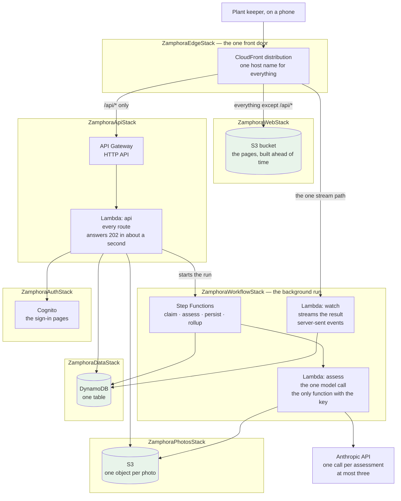

**How to read it.** Boxes are things that run or store data. Arrows are calls. Each outline is one
stack. Start at the phone and follow the arrows down. Look at the `web` box: no arrow goes from it to
the table or the photos. The web pages hold no passwords and cannot reach any data. The two alarm
stacks are not in the picture, because they only watch.

### One assessment, step by step

The best way to see how the stacks work together is to follow one request.

1. A person takes a photo of their monstera on the phone and taps **Assess**.
2. The request goes to **CloudFront**. The path starts with `/api/`, so CloudFront sends it on to
   **API Gateway**, and API Gateway calls the **`api` Lambda**.
3. The `api` Lambda checks the session and the photo. It saves the photo in the **photos bucket**. It
   writes a row in **DynamoDB** with the status `queued`. It starts **Step Functions**. Then it
   answers `202 Accepted`. All of this takes about one second.
4. **Step Functions** is an AWS service that runs a list of steps for you, with retries. It runs the
   **`assess` Lambda**, which sends the photo to the **Anthropic API**. It tries at most three times.
5. Step Functions writes the result into the same DynamoDB row.
6. While this happens, the phone keeps one connection open to the **`watch` Lambda**. When the row
   changes, `watch` sends the result to the phone. In the browser, this is the same thing as an
   `EventSource` that listens for server-sent events.

### Four decisions in this picture

Each of these was a choice. Each one had another option that lost.

- **The web pages are only static files.** They hold no credentials, so a bug in the web app cannot
  read or change any data. All data goes through the API. The other option was a Next.js server. A
  Next.js server can hold secrets, but then it is one more thing that can leak them.
- **One Lambda handles every API route.** One function is easier to understand, and you pay for one
  cold start instead of many. The other option was one function per route. That keeps the routes
  more separate, but there are many more pieces to deploy. Section 7 says more.
- **There is no VPC.** A **VPC** is a private network inside AWS. To reach the Anthropic API from a
  VPC, you need a **NAT Gateway**. AWS charges for it every hour, and there is no free offer. It
  would be the biggest cost in the whole product.
- **Only the `assess` Lambda can read the Anthropic key.** If someone breaks into the `api` Lambda,
  they still cannot use the key. This is the reason `assess` is its own function. And `assess` never
  decodes a photo, so a bad image cannot attack the function that holds the key.

There is also no domain name of our own. The app uses the CloudFront address, for example
`d111111abcdef8.cloudfront.net`. A domain in Route 53 costs $0.50 every month. At this size, that is
more than all the other costs together.

### Why one stack is in us-east-1

CloudFront sends its **metrics** (its numbers, such as the error rate) only to **us-east-1**. You
cannot change this. An alarm must be in the same Region as the metric it watches. So the two
CloudFront alarms live in their own small stack in us-east-1.

- No person's data ever goes through that stack. The rule "everything that serves a request is in
  Frankfurt" still holds.
- **The trap:** an alarm in the wrong Region does not fail. It deploys without an error, and then it
  never fires.

---

## 3. The path of one request

Every request arrives at one CloudFront distribution, on one host name. CloudFront looks at the path
and sends the request to one of three places.

Because everything is on one host name, the app needs **no CORS** at all. **CORS** is the set of
browser rules for calling a different host than the one the page came from. Each of those rules is a
place where a wrong value either breaks the app or opens it. With one host, none of them exist.

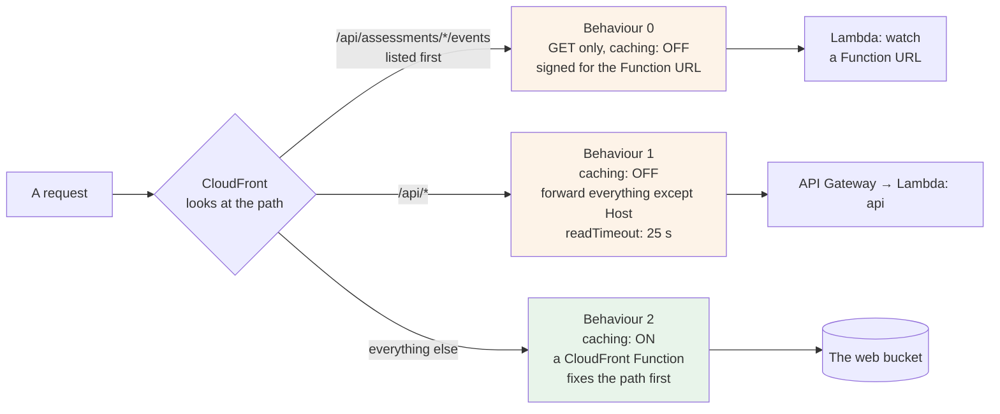

**How to read it.** CloudFront tries the rules from the top and takes the first one that matches. So
the order is part of the meaning. Each arrow label is a URL pattern, and together they are the whole
public surface of the product.

**Why the stream path is listed first.** `/api/assessments/42/events` also matches `/api/*`. If
`/api/*` were first, the stream rule would never be used. The stream goes to a **Lambda Function
URL**, which is an HTTPS address that a function can have on its own, without API Gateway. It is
needed because the API Gateway HTTP API cannot stream a response. This path accepts only `GET`.
Every `POST` goes through API Gateway.

**Three traps in this small picture. All three fail without an error.**

- **Caching must be OFF for `/api/*`.** If `GET /api/me` were cached, one person could get another
  person's answer. Nothing would report an error.
- **The `Host` header must not be forwarded.** API Gateway refuses a request with someone else's
  `Host`, and the error is a 403 that looks like a permission problem. Everything else must be
  forwarded, including cookies, or the session never reaches the API. The CDK setting that does both
  is `ALL_VIEWER_EXCEPT_HOST_HEADER`.
- **The static pages need a small path fix.** Next.js writes the Hungarian home page as
  `/hu/index.html`, but the browser asks for `/hu`. The bucket answers that with a 403, not a 404, so
  the error tells you nothing. A small **CloudFront Function** adds `index.html` to the path. It also
  sends `/` to `/hu` or `/en`, because a static site has no server to read the browser's language.

**Where the session lives.** The browser holds one cookie, `__Host-session`. Its value is a random
id that means nothing on its own. The Cognito tokens never reach the browser: the API reads them,
throws them away, and writes a session row in the table. This shape is called **backend for
frontend** (BFF). Signing out is simply deleting that row.

---

## 4. Why the model call runs in the background

### The problem

The product promises **30 seconds** from the tap to something on the screen. The slowest part is the
model call. It takes several seconds, and nobody can say exactly how long.

At first, the phone waited while the model answered. Then the model call sat under four clocks. Each
layer between the phone and the code had its own **timeout**, which is the longest time it waits
before it gives up:

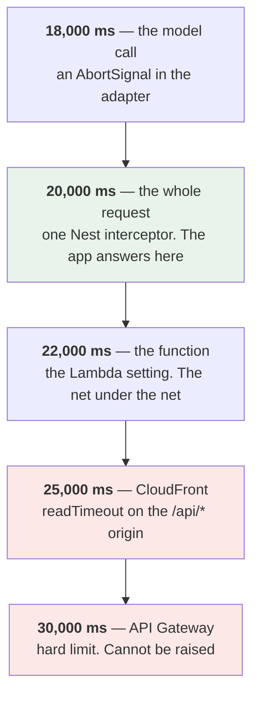

**The rule behind this picture works in any project: your application must give up before the
platform does.**

- If the app gives up first (the green box), it writes its own error message. The message can say
  whether trying again will help.
- If a platform gives up first (the red boxes), the person gets a **504** with a body nobody in the
  product wrote. It has no explanation and no next step.
- The **cold start** comes before all these clocks. The code that starts the clock cannot run until
  the function has started. So you plan the start-up time separately, outside the deadline.
- **Once the model has answered, the app must always finish writing the result.** The call is
  already paid for, and one of the person's ten daily attempts is already used.

This shape worked, but it left the model only about 16 seconds, and a retry was not possible. A
second try would use the same clock.

### What it looks like now

Now the `api` function answers `202` in about one second, and the model call runs inside a Step
Functions workflow. **Every step has its own clock, and no platform limit sits above them.**

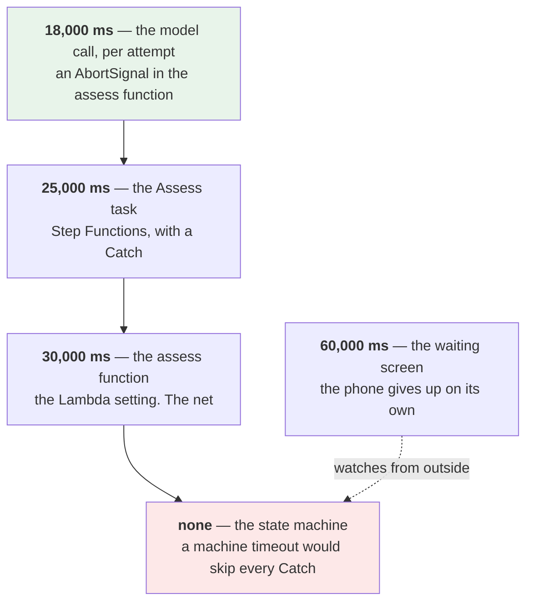

- **The 30-second promise is kept by the waiting screen.** The screen confirms within 30 seconds
  that the run has started. The result then arrives within 60 seconds.
- **A retry is possible again, with a limit.** The workflow retries a timeout, a 429 or a 503 at most
  twice, after 2 and then 4 seconds. Every retry is a paid call, so this limit is a cost control. The
  workflow counts its own model calls in a variable, `callsMade`, and stops at three. A test reads
  this rule from the deployed workflow.
- **The trap of this shape: no timeout on the whole state machine.** If the whole machine timed out,
  it would stop without running any error handler, and the row would stay `running` forever. So each
  step has a timeout and a **`Catch`** (an error handler), and the machine itself has none.

Section 7 says how this shape was chosen, and what the container version would look like.

---

## 5. One table, and a choice AWS does not recommend

All the data is in **one DynamoDB table**. DynamoDB is a key-value store: you find an item by its
key. There are no joins and no free search.

Everything a person owns has the **same partition key**: their user id. The **sort key** says what
kind of thing the item is, with a readable prefix:

```
PK = USER#<sub>          SK = PROFILE                      the account
PK = USER#<sub>          SK = POT#<potId>                  one plant pot
PK = USER#<sub>          SK = ASSESS#<potId>#<timestamp>   one assessment
PK = USER#<sub>          SK = TASK#<due date>#<taskId>     one care task
PK = USER#<sub>          SK = QUOTA#<yyyy-mm-dd>           today's attempt count
PK = USER#<sub>          SK = IDEM#<requestId>             one claimed request
PK = SESSION#<opaque id> SK = SESSION                      one sign-in
PK = CONFIG              SK = AI_ENABLED | BREAKER | ...   settings
```

**This key design removes the most common access bug.** The most common bug is a query that forgets
to check who owns the data. Here the owner id *is* the key, so you cannot write a query without an
owner.

- The repository code takes a special `UserId` type. That type can only be created where the session
  is read. So a query without an owner does not even compile.
- **The API never answers 403.** Another person's row gets the same answer as a row that does not
  exist: 404. A 403 tells an attacker "this exists, but you cannot have it". A 404 tells them
  nothing.

### The choice AWS does not recommend

DynamoDB has two ways to pay. **On demand**: you pay for each request. **Provisioned**: you reserve a
fixed number of capacity units and pay for holding them. AWS's own documentation calls on demand
*"the default and recommended throughput option for most DynamoDB workloads"*.

**zamphora uses provisioned, with fixed numbers and auto scaling switched off.** There are two
reasons.

1. **The free amount only covers provisioned.** An on-demand table costs money from its first read.
2. **It fails in the better direction.** This reason works in other projects too:

| | A bug sends far too many requests to the table |
| --- | --- |
| **Provisioned, fixed** | DynamoDB **refuses** the extra requests. The app breaks loudly, an alarm fires, and someone notices |
| **On demand** | DynamoDB **serves** every request, perfectly, and spends the money that keeps the account open |

Auto scaling is off for the same reason: it would raise the numbers past the free amount without
asking anyone. On a paid account, on demand would be the right answer. ADR-0002 writes this down,
including the AWS quote that recommends the opposite.

### Changing the shape of an item

DynamoDB has no schema and no migration tool. An assessment row is kept as long as the pot exists,
so an item written today may still be read in three years.

Every item has a field **`v`**, a whole number. Today it is `1`. Three rules go with it:

1. **A reader ignores a field it does not know.** So adding a field is always safe.
2. **Never rename a field, and never change what a field means.** Write a new field instead.
3. **Raise `v` only when a reader must behave differently.** Keep the code that reads the older
   version until no item uses it.

---

## 6. The photo path

Photos are the only large thing zamphora stores. They are also the only thing in it that is clearly
personal data. Each photo is one object in one private S3 bucket, at
`photos/<userId>/<potId>/<timestamp>.jpg`.

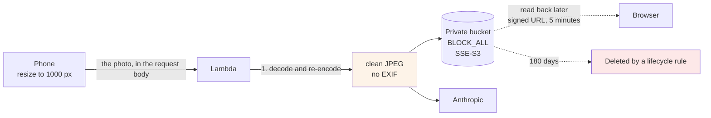

**How to read it.** Follow one photo from left to right. It arrives at the API, it is re-encoded, it
is saved in the bucket, and later it is read back through a signed link. Notice what is missing:
nothing goes from the browser straight to the bucket.

**Four decisions in this picture.**

- **The photo goes through the API.** The usual pattern is a **presigned PUT**: the server gives the
  browser a short-lived link, and the browser uploads straight to S3. It lost here because **a
  presigned PUT checks nothing.** Any bytes the browser sends land in the bucket, with no check of
  size, type or content.
- **The API decodes the photo and writes a fresh JPEG.** This one step does three jobs:
  - It removes **EXIF**, the hidden data in a phone photo. EXIF holds the GPS position where the
    photo was taken. For a plant on a windowsill, that is the person's home.
  - It proves the file is really an image. A file name or a declared type proves nothing. A file
    that cannot be decoded is not an image.
  - It turns the photo the right way up. The rotation is stored in the EXIF, so it must be applied
    before the EXIF is removed.
- **The bucket is never behind CloudFront.** Photos are read through a **signed URL**: a link that
  carries its own permission and works for at most five minutes. A cache would make a copy, and then
  "delete my photo" would have to find that copy too.
- **Photos are deleted after 180 days by an S3 lifecycle rule**, not by app code. The rule lives
  inside S3, so it keeps working even when the app is broken. The general rule: if a promise must
  work when the app is broken, do not put it in the app.

S3 lifecycle deletion can be up to a day late, and DynamoDB's time-to-live deletion can be a few
days late. So no rule may depend on either one being on time. The retention check looks at day 182,
not 180.

---

## 7. The function itself

The `api` Lambda holds the whole Nest.js API. Two more functions are built from the same code, and
each has one job.

| Setting | `api` | `assess` | `watch` | Why |
| --- | --- | --- | --- | --- |
| Runtime | `nodejs24.x` | same | same | Supported until April 2028. Node 22 stops a year earlier |
| Architecture | `ARM_64` | same | same | Cheaper per second |
| Memory | 1024 MB | 1024 MB | 512 MB | Lambda gives more CPU with more memory. To be measured |
| Timeout | 22 s | 30 s | 60 s | The last safety limit under each function's own clocks |
| Reserved concurrency | **10** in prod, 2 in dev | **1** | 5 | A cost guard |
| Holds the model key | no | **yes** | no | The key is in the function that has no route |

**Reserved concurrency** is the largest number of copies of a function that may run at the same
time. `assess` is set to 1. So a bug cannot start a thousand copies that each make a paid model call.
One user only ever needs one at a time.

### One function for every route: the Lambdalith

One Lambda that holds a whole framework is called a **Lambdalith**. It is a known pattern, not a
mistake.

- **It scales as well as many small functions.** Lambda scales by starting more copies. It does not
  care how many routes are inside one copy. The account starts with a limit of 1,000 copies at the
  same time, and AWS raises it for free when you ask.
- **In zamphora, the table reaches its limit long before the function does.** 20 read units is about
  20 reads a second. So the things that break first are the money and the table, not the shape of the
  function.
- **Its real weak point is the noisy neighbour.** All routes share one reserved concurrency number.
  If one slow route fills all the copies, the fast routes must wait or are refused. In zamphora the
  slow model call runs in its own function, `assess`, so it cannot fill the `api` copies.
- **Its price is IAM.** One function has one **execution role**, which is the set of permissions the
  code runs with. So `GET /api/health` has the same table and bucket permissions as every other
  route. One function per route would let each route have only what it needs. If the API is ever
  split, split the role too.

The key design in section 5 does not fix this. It stops a route from reading another person's data
by mistake. But if an attacker makes code run inside the function, that code has the whole role.

### Two build traps with the same shape

Both traps build without an error, deploy without an error, and then break on the first real
request.

**Trap 1: decorator metadata.** Nest.js finds what to inject into a constructor by reading
**decorator metadata**, which TypeScript writes into the output when `emitDecoratorMetadata` is on.
**esbuild cannot write it.** CDK's `NodejsFunction` uses esbuild. So if you point it at the
TypeScript source, the function fails with `Nest can't resolve dependencies`.

```
Wrong:  NodejsFunction  ->  apps/api/src/main.ts     (esbuild only)
Right:  nest build      ->  apps/api/dist/main.js  ->  NodejsFunction
```

`nest build` uses `tsc`, which writes the metadata. esbuild then only bundles the finished
JavaScript.

**Trap 2: a native module.** `sharp` is the library that decodes and re-encodes the photo. Most of
the real work is in a compiled binary file, not in JavaScript. **A bundler cannot put a binary into a
bundle.** So the function fails with `Cannot find module 'sharp'` on the first photo.

- The fix: mark `sharp` as external, so esbuild leaves it alone. Then copy the real folder into the
  function after the bundle step. The code is in `docs/800-infra/01-iac-plan.md` §4.4.
- `sharp` keeps its binaries in separate packages under `node_modules/@img`. The package manager
  installs only the one for the current machine. So the build must run on a **Linux arm64** machine,
  the same kind as Lambda. That is why CI uses `ubuntu-24.04-arm`.

**The lesson for any project:** a bundler only understands JavaScript. If your build depends on
anything else, such as metadata from the compiler or a binary file, check every build path
separately.

### If money were no object: the same product as a container

The whole design follows one rule: nothing may cost money while nobody uses the app. So it is useful
to ask: **without that rule, what would the better system look like?** The answer is not the same
thing but bigger. It is a different shape.

The service would be **Amazon ECS on Fargate**. ECS runs containers. Fargate means AWS runs the
machine for you, so you have no server to patch. Your Nest.js app becomes a normal HTTP server that
runs all the time, the same as on your laptop.

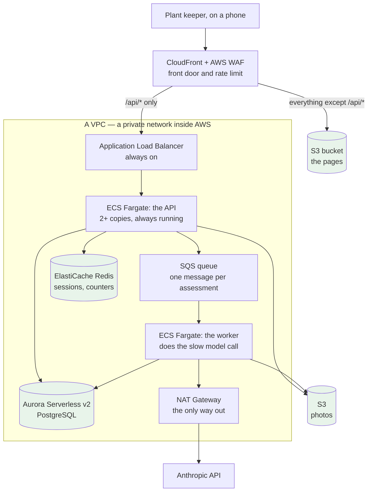

**The most important piece is the queue.** `POST /api/assessments` writes a message to **SQS**, a
queue of jobs waiting to be done, and answers `202` at once. A separate worker takes the job and
makes the slow call. zamphora gets the same result for free: Step Functions plays the part of the
queue and the worker.

| Today | If money were no object | What that gives you |
| --- | --- | --- |
| One Lambda function | ECS Fargate, 2+ copies always running | No cold start. A database connection pool works normally |
| API Gateway HTTP API | Application Load Balancer | No 30-second limit |
| Step Functions | SQS and a worker service | The same: slow work leaves the request |
| DynamoDB, one table | Aurora Serverless v2 PostgreSQL | Joins, reports and free questions over the data |
| A value in the function's memory | ElastiCache Redis | One cache that every copy shares |
| No VPC | A VPC with a NAT Gateway | The database and the cache cannot be reached from the internet |
| Reserved concurrency and an alarm | AWS WAF rate rules | A flood is stopped at the front door |

**What does not change:** the Zod contracts, every screen, the domain rules and the `LlmProvider`
port. Only two parts are rewritten: the repository layer, because DynamoDB keys become SQL, and the
handler, because a Lambda event becomes an HTTP request.

**The cost is why this is not the design.** These are rough estimates, per month, with nobody using
the app:

| Piece | Roughly, per month, idle |
| --- | --- |
| Application Load Balancer | ~$18 |
| NAT Gateway | ~$32, plus data |
| Fargate, API and worker | ~$30 |
| Aurora Serverless v2, at its smallest | ~$45 |
| ElastiCache, smallest node | ~$12 |
| AWS WAF | ~$6 |
| **Total, before a single request** | **~$150** |

Today the product costs about **two cents** a month. With $200 of credit, the container version
would close the account in about six weeks, with nobody using it.

**It wins later.** Lambda charges for each request. A container charges for each hour, even when
nobody calls it. With steady, high traffic, the container becomes cheaper and also faster. The move
is right when two things are both true: the account is on a paid plan, and the traffic is steady.

### How the background shape was chosen

Two shapes were scored, in `docs/400-architecture/00-options.md` §11 and `08-async-options.md`.

- **Option E, chosen.** Only the model call moves. The API answers `202`, Step Functions runs the
  call in its own small function with its own role, and the phone listens over server-sent events.
  Step Functions gives 4,000 free steps a month, forever. zamphora uses about 200.
- **Option F, not chosen.** The phone uploads straight to S3, and every change in the table becomes
  an event that other small functions react to. Nothing the project plans to build needs this.

**The lesson for any project:** a background shape moves the risk of a runaway loop from your code
to the services' own retries. Lambda, EventBridge and Step Functions each retry on their own by
default, and each retry can cost money. Each one has a setting, and `08-async-options.md` §8 lists
all thirteen.

---

## 8. What stops it from costing money

On an account that closes instead of sending a bill, cost is a question of correctness. So there
are several layers of defence, and each layer catches something the others cannot.

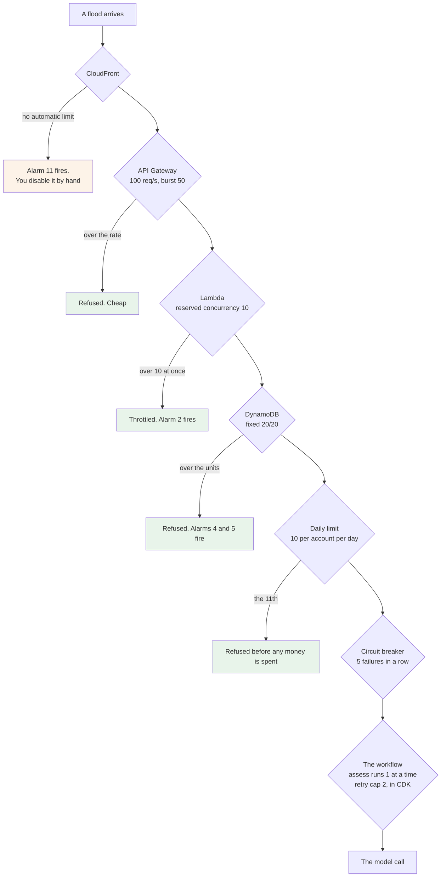

**How to read it.** Start at the top with a flood of requests. At each layer, ask what gets through
and what is refused.

**There are two different balances to protect.**

- The **Anthropic** balance is $5. It pays for the model calls. The daily limit, the circuit breaker
  and the retry limit protect it.
- The **AWS** balance is the credit that keeps the account open. The gateway limit, the reserved
  concurrency and the fixed table capacity protect it.

**The gateway rate limit is the layer people forget.** If you do not set it, API Gateway uses the
account default: **10,000 requests a second**. API Gateway has no free offer, so a flood at that
rate costs about **$36 an hour**. And the sign-in check runs inside the function, so even a stranger
who is not signed in costs one gateway request.

Reserved concurrency does **not** help here. It limits how much the function works. It does not
limit how many gateway requests are billed. These are two different meters.

**Three default settings that are wrong on this account.** The background workflow brought them in:

- The CDK task for Lambda adds a hidden retry of up to six attempts. It is switched off with
  `retryOnServiceExceptions: false`.
- An EventBridge rule retries a broken target for 24 hours. Here it is set to 2 attempts and 5
  minutes.
- A queue that a function reads costs requests even when it is empty. So the only queue here is a
  dead-letter queue that nothing reads automatically.

**One layer has no automatic defence, and this is written down.** CloudFront has no rate limit on
this account. Once its free 10 million requests are used, a flood costs money, and nothing stops it
automatically. The answer is manual: an alarm fires on the request count, and you switch off the
distribution by hand. An accepted risk that is written down is better than a defence that does not
exist.

**Things that cost money quietly, and are switched off or limited:**

- **Detailed API Gateway metrics** are charged. The basic ones are free.
- **CloudWatch Logs** are charged for each gigabyte written. Logs are kept for 30 days in `prod` and
  7 days in `dev`.
- A **dimension** is a label that splits one metric into several. Putting the error code on a
  dimension would turn 6 custom metrics into 36, and each one is charged. The error code is read
  with a free Logs Insights query instead.
- **There are no backups.** DynamoDB point-in-time recovery is charged for each gigabyte. Instead,
  there is a calendar entry: export the table and the photos by hand before the free plan ends.

---

## 9. What you can see when it breaks — observability

**Observability** is a standard backend topic, and it is close to a non-functional requirement. It
asks one question: **can you tell what the running system is doing, without a debugger?** You cannot
debug a Lambda that ran once at 3 a.m. for someone else and no longer exists. Observability is what
you have instead.

**It has three parts:**

| Part | The question it answers | The AWS tool | In zamphora |
| --- | --- | --- | --- |
| **Logs** | **What happened in this one request?** Which route, which result, and why it ended in a `400` or a `409` | **CloudWatch Logs** | One structured line per request, with an error code |
| **Metrics** | **How many, how often, how fast?** How many requests, how many worked, how slow the slowest 5% were | **CloudWatch Metrics** | AWS's own metrics, plus six custom ones |
| **Traces** | **Which services did this one request pass through, and where did the time go?** | **AWS X-Ray** | `api` → Step Functions → `assess` → Anthropic |

- **A log line is about one event and is charged per gigabyte. A metric is a number over time and is
  cheap to keep for a year.** So "how many calls failed today" must be a metric. Answering it by
  reading a year of logs is slow and expensive.
- **Traces matter once a request crosses several services.** Inside one program, a stack trace shows
  the whole path. When a request passes through four services, no single machine has seen all of
  it. A trace gives the request an id that travels with it, so you can see which step was slow.

`backend-concepts.md` entry 55 explains the same three parts away from AWS.

### What is watched in zamphora

There are twelve alarms and one dashboard, in `ZamphoraOpsStack`. Most are normal alarms that any
system has. **Four are special to this project, and each one is about a balance:**

| Alarm | Fires when | What it means |
| --- | --- | --- |
| **Runaway model calls** | more than 30 in an hour | Normal use is about 30 a **month**. Thirty in an hour is a loop or an attack |
| **Runaway spend** | more than $0.10 in an hour | With $5 of balance, a dollar an hour empties it in one evening |
| **The breaker opened** | 5 model calls failed in a row | The product stopped calling the model by itself |
| **Front door flood** | more than 50,000 CloudFront requests in an hour | The only warning of a flood that never reaches the gateway |

CloudWatch gives ten alarms for free, so two of the twelve are charged. That is a few cents a month.

**Three things about measurements that are easy to get wrong:**

- **There is no `InitDuration` metric in CloudWatch.** The cold-start time is written into a log
  line, so you read it with a Logs Insights query.
- **CloudFront metrics exist only in us-east-1.** An alarm in another Region deploys without an error
  and never fires (section 2).
- **Check that a borrowed number describes the same thing.** The first cold-start budget was 800 ms,
  taken from published numbers. Those numbers were for a plain Node.js handler. A bundled Nest.js app
  is closer to 900 ms when it is almost empty. The budget is now 2,000 ms.

---

## 10. Two switches that look the same and are not

Both switches stop the AI feature. They are completely separate, and each one solves a different
problem.

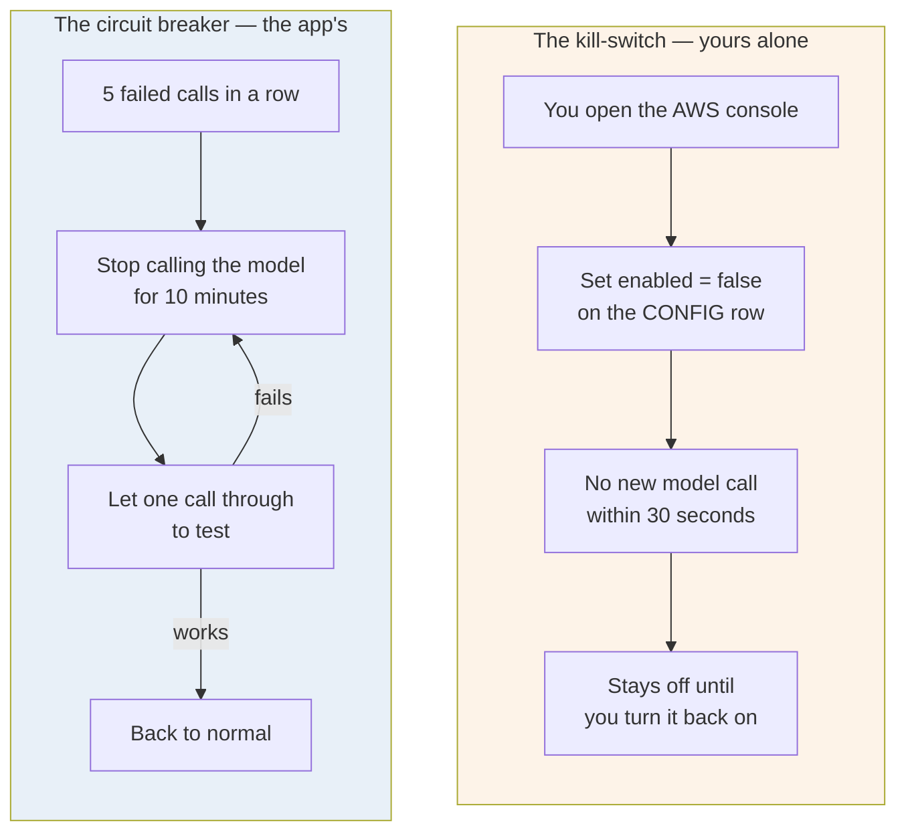

**The breaker never writes the kill-switch row.** It has its own row. So both of these are true at
the same time:

- The **kill-switch** is yours. It stays off until **you** turn it on. The app never touches it.
- The **circuit breaker** is the app's. If the model fails again and again at 3 a.m., the app stops
  calling it, and starts again by itself when the problem is gone.

If there were only one switch, the app would have to write your switch. That would break the
decision that only a person may flip it. With two rows, the decision stays true and the app is still
protected.

**Two more details on the same path:**

- **The breaker is checked before the daily attempt is counted.** So an open breaker does not use
  one of the person's ten tries.
- **A double tap does not cost twice.** On a weak signal, people often tap twice. So the browser
  makes one id per photo, and the API claims that id in the table before it counts the attempt. The
  second tap finds the id already claimed and gets the first result back.

---

# Part B — the pipeline

## 11. How the build signs in to AWS with no password

This is the most important part of the pipeline.

### The usual way, and why it is dangerous

The usual way: you create a user in AWS, get an **access key** and a **secret key**, and paste both
into GitHub secrets. The build signs in with them.

These two strings are a **permanent password**. They work from anywhere, forever, until someone
changes them. If one appears in a log, in a screenshot or in a tool your build runs, someone else
owns your account. This is the most common way AWS accounts are taken over.

**There is no access key anywhere in this project.**

### What happens instead: OIDC

The build uses **OIDC** (OpenID Connect). GitHub gives the build a signed token, and AWS trusts that
token.

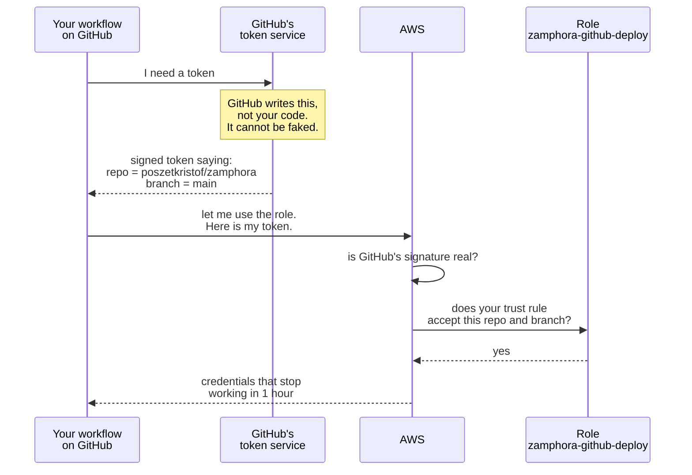

**How to read it.** It is a sequence diagram: read it from top to bottom. Each arrow is one message.

**The key step is the second one.** **GitHub** writes and signs the token, not your workflow. Your
workflow cannot write its own token, and it cannot change what the token says.

So there is nothing to steal. Someone can copy the whole public repository and still reach nothing,
because they cannot make GitHub sign a token that says they are this repository on this branch.

### The one line that makes it safe

The role's **trust rule** names the branch, not only the repository:

```
repo:poszetkristof/zamphora:ref:refs/heads/main     <- correct
repo:poszetkristof/zamphora:*                       <- wrong, and it looks fine
```

The second line accepts **any branch** in the repository. Every pull request creates a branch. So
that one `*` decides whether a pull request can deploy to production.

### Three roles, not one

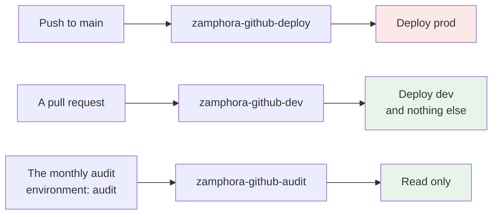

- If the `dev` role could also deploy, any pull request could change production. A second role costs
  nothing.
- Neither role ever writes a `CONFIG` row. The owner writes those by hand.

**Why there is a third role.** The monthly retention audit runs on a schedule. A scheduled workflow
runs on the main branch, so its token says `ref:refs/heads/main`. That matches the **deploy** role.
So a job that runs every month, with nobody watching, would have full deploy rights.

The fix: the workflow declares `environment: audit`. Then GitHub writes `environment:audit` into the
token instead of the branch. The deploy role does not match it, and the audit role can only read.

**The lesson:** when a document says "this job uses a read-only role", check that the role really
exists. A sentence in a document is not a trust rule.

---

## 12. A public repository, and the two walls

The repository is **public** on purpose. So anyone can read it, and anyone can **fork it and open a
pull request**. No setting stops that. Branch protection stops a **merge**, not an **open**.

A pull request contains someone else's code, and pull requests run your build. So the question is:
what can that code reach?

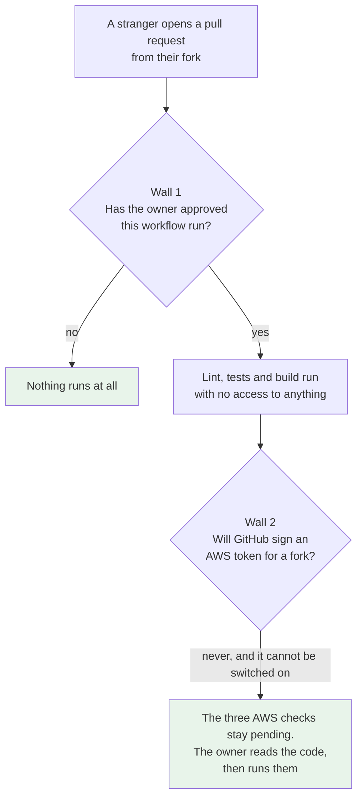

- **Wall 1 is ours.** The repository setting *"Require approval for all external contributors"*
  means nothing runs until the owner approves it. Every time, not only the first time.
- **Wall 2 is GitHub's.** GitHub never gives secrets or an AWS token to a workflow started by a
  pull request from a fork. There is no switch for it.

### The one way to break it

Someone sees three checks stuck on "pending", searches the internet, and finds
**`pull_request_target`**. This trigger runs a pull request **with your secrets**. That means a
stranger's code and your AWS access in the same run. `docs/800-infra/04-ci-cd.md` §4 says: never
use it.

### Why every action is pinned to an exact commit

```yaml
uses: actions/checkout@v7        # a label. Its owner can move it to different code, any time.
uses: actions/checkout@8f4b7f8…  # an exact commit. It can never change.
```

`v7` is only a label. The owner of the action can point it at new code at any time, and your next
build runs that new code. OIDC does not protect you here, because the attacker's code already runs
inside your workflow, next to the AWS credentials. Pinning to a commit removes this risk.

You still get updates: **Dependabot** opens a pull request when a new version exists, and you
approve it.

---

## 13. What must be green before a merge

GitHub has **two different kinds of merge rule**, and mixing them up is the trap.

- A **required status check** watches one job in a workflow.
- A **code scanning rule** watches what CodeQL found. It is not a job, so a required status check
  cannot cover it.

So this repository needs both kinds.

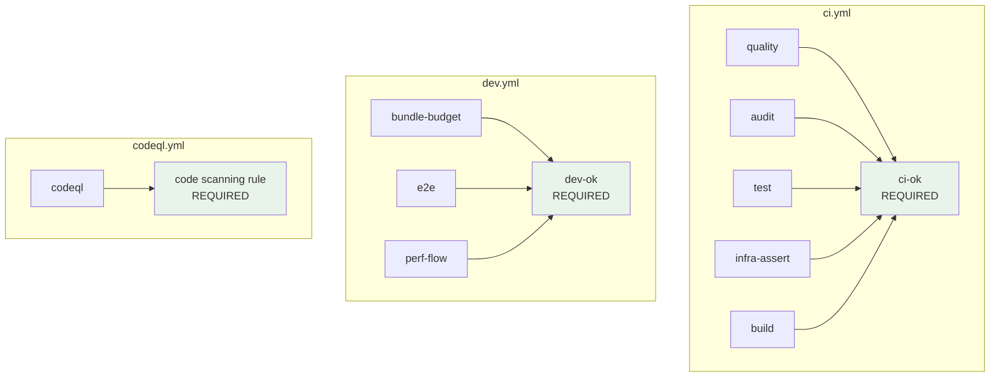

- **One summary job per workflow.** If the settings listed eleven job names, a job you add next month
  would not be required until you remember to edit the settings. A summary job, such as `ci-ok`,
  lists the jobs it needs in code, so adding a job is a reviewed code change.
- **The summary job uses `if: always()`.** In GitHub, a **skipped** check counts as a **pass**.
  Without `always()`, a failed `build` would make `ci-ok` skip, the skip would count as green, and
  the broken build would merge. So `ci-ok` always runs and checks each job's result itself.
- **A test that can only pass is not a test.** The performance test replaces the model with a fake
  that waits 8,000 ms. But 8,000 ms is only a guess. So the test also runs with 18,000 ms, the
  model's own timeout. Both runs must still keep the 30-second and 60-second promises. A third run
  makes the fake fail twice and then answer, to prove the retry limit works.

**Two facts to remember:**

- **A pull request from a fork can never pass `dev-ok`**, because GitHub never gives a fork an AWS
  token. So a stranger's pull request can never merge by itself. This is accepted, because the owner
  merges their own branches.
- **A required check that never reports blocks every merge, forever.** So `dev-ok` is added to
  branch protection in the same change that adds the workflow, never before.

---

# Part C

## 14. Lookup: what was chosen, and what lost

You do not need to remember this table. Come back to it when you need it.

| Question | Chosen | What lost, and why |
| --- | --- | --- |
| Compute | **One Lambda for every route, plus `assess` and `watch`, split by job** | One function per route: many cold starts and many small pieces. A container: charged every hour, even at night when nobody uses the app |
| Database | **One DynamoDB table, provisioned, fixed** | On demand: AWS recommends it, but the free amount does not cover it, and it serves a runaway loop instead of refusing it |
| Test environment | **One permanent `dev`, next to `prod`.** Units split 20/20 and 5/5 | A new copy for every pull request: every new table would need its `CONFIG` rows written. No test environment: three kinds of test would have nothing to run against |
| Photo upload | **Through the API** | Presigned PUT straight to S3: it checks nothing |
| Photo handling | **Decode and re-encode every photo** | Reading only the header: it cannot remove EXIF, so the person's home GPS would reach storage and the model |
| Photo deletion | **An S3 lifecycle rule** | App code on a schedule: it stops working exactly when the app is broken |
| A cache in front of the table | **None** | ElastiCache or DAX: saves 24 ms out of 8,000, is charged every hour, and needs a VPC with a NAT Gateway |
| The API build | **`nest build`, then esbuild bundles the result** | esbuild alone: it cannot write decorator metadata, so the function fails on its first request |
| Gateway rate limit | **100 a second, burst 50** | Not set: 10,000 a second, about $36 an hour in a flood |
| Region | **eu-central-1**, Frankfurt | Ireland: also EU, but further away. Virginia: the data would leave the EU |
| CloudFront alarms | **A small stack in us-east-1** | In eu-central-1: they deploy without an error and never fire |
| Host name | **CloudFront's free name** | A bought domain: $0.50 a month, the biggest cost in the product |
| Sign-in | **Cognito, with the tokens kept in the API** | Tokens in the browser: a browser cannot keep a secret, so any script bug becomes token theft |
| Cognito tier | **Essentials** | Lite: only the older sign-in pages and no branding. Both are free at this size |
| Backup | **None in run 1** | Point-in-time recovery: charged per gigabyte. Instead, a manual export before the free plan ends |
| Repository | **Public** | Private: CodeQL is not free, and Actions minutes are limited |
| Deploy | **A person presses the button** | Deploy on every merge: normal on a paid plan, but here one bad merge can close the account |
| Sign-up | **Closed. The owner creates accounts** | Open sign-up: the daily limit is per account, so ten accounts means ten times the spend |
| Circuit breaker | **Heals itself, with its own row** | Flipping the real kill-switch: the app would write the owner's switch |
| Local development | **DynamoDB Local and MinIO** | Real AWS: every local test would use the free amount and mix test data with real data |
| Required checks | **One summary check per workflow, such as `ci-ok`** | Eleven separate entries: a new job you forget to add is never required |
| Actions | **Pinned to exact commits** | Version labels: easier to read, but the code can change under you |
| Node version | **24 everywhere** | Node 22: supported for one year less |
| Background assessment | **Option E: Step Functions, server-sent events, a retry limit of 2** | The phone waits: a 30-second limit and no retry. Option F: nothing planned needs it. The container shape: about $150 a month idle |

**Still open:**

- **One setting in GitHub.** `aws-actions/configure-aws-credentials` is Amazon's action, not
  GitHub's, and the current allow-list refuses it. It must be allowed before the first deploy.
- **`.github/workflows/ci.yml` still uses npm.** Every command must change to pnpm before the first
  `package.json` is added. `docs/800-infra/04-ci-cd.md` §6.1 lists the six changes.

Every number in this note comes from `docs/800-infra/`. Those five files are the plan. This note is
the reason behind it.
