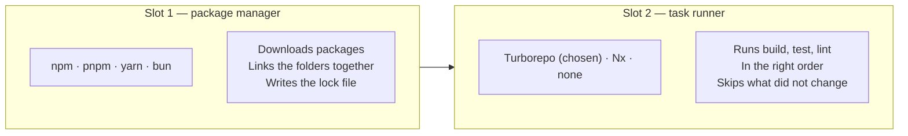
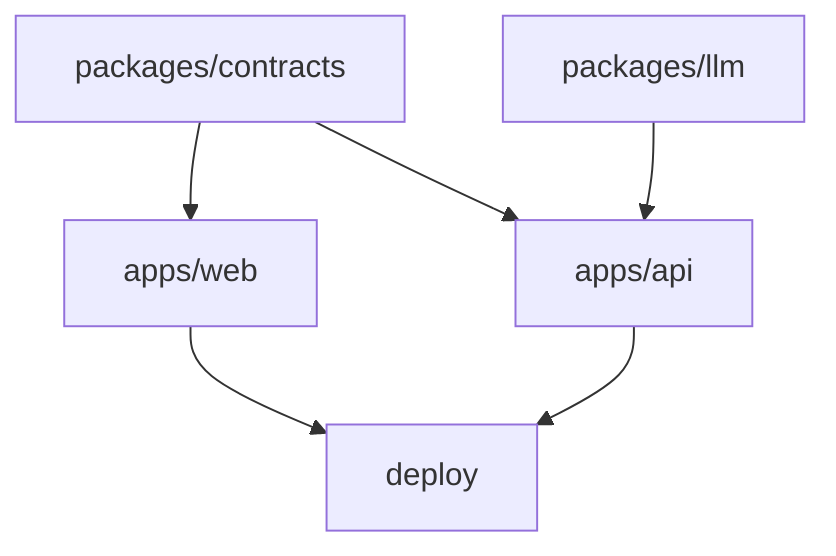
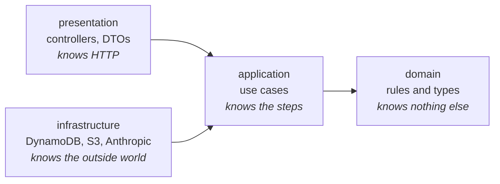
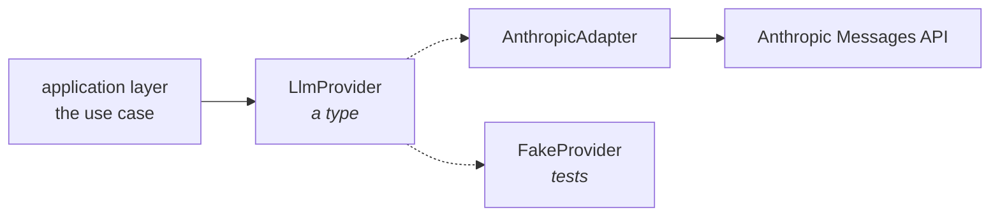

# Monorepo architecture

**What this note is.** One repository holds the web app, the API, the shared code and the
infrastructure. This note explains how that is arranged, which tool does which job, and why each
choice was made. It assumes you know React and TypeScript. It assumes nothing about workspaces.

**Every version number below was read from the npm registry on 2026-08-26.** Versions go out of date,
so check them again before you trust one.

The ideas underneath this note are explained on their own in `backend-concepts.md`: **63** monorepo
and polyrepo, **60** clean architecture, **61** dependency injection, **62** monolith and
microservices, **66** the testing pyramid, and **73** RAG.

---

## Contents

1. [The problem a monorepo solves](#1-the-problem-a-monorepo-solves)
2. [Two jobs, two tools](#2-two-jobs-two-tools)
3. [What a workspace is](#3-what-a-workspace-is)
4. [Why pnpm and not npm](#4-why-pnpm-and-not-npm)
5. [The catalog: one place for versions](#5-the-catalog-one-place-for-versions)
6. [allowBuilds: why pnpm asks permission](#6-allowbuilds-why-pnpm-asks-permission)
7. [Turborepo and Nx: what a task runner does](#7-turborepo-and-nx-what-a-task-runner-does)
8. [What real projects use](#8-what-real-projects-use)
9. [The layout](#9-the-layout)
10. [Inside the API: clean architecture](#10-inside-the-api-clean-architecture)
11. [Inside the web app: how Next.js wants it](#11-inside-the-web-app-how-nextjs-wants-it)
12. [Sharing code, and the React Native question](#12-sharing-code-and-the-react-native-question)
13. [Why the model call has its own package](#13-why-the-model-call-has-its-own-package)
14. [Why TypeScript 6 and not 7](#14-why-typescript-6-and-not-7)
15. [How this deploys](#15-how-this-deploys)
16. [Every trigger on one screen](#16-every-trigger-on-one-screen)

---

## 1. The problem a monorepo solves

zamphora has a web app and an API that talk to each other. When the assessment answer gets a new
field, three things change together: the Zod schema, the API that fills the field, and the screen that
shows it.

If those three live in three repositories, that one change is **three pull requests in a fixed
order**, and you cannot test anything until all three are merged. Cloudflare reported four pull
requests per change before they automated it down to one.

**A monorepo makes it one commit.** That is the whole idea. Everything else in this note is the tooling
that keeps one repository tidy as it grows.

The cost is real: one repository can turn into one big tangle, where every file imports every other
file. Most of this note is about preventing that.

---

## 2. Two jobs, two tools

This is the idea that makes the rest of the note make sense.

**There are two separate jobs, and you choose a tool for each one.**



| | Package manager | Task runner |
| --- | --- | --- |
| Answers | "Where do the files come from?" | "What do I run, and in what order?" |
| Do you always need one? | Yes | **No.** You can start without one |
| Options | npm, **pnpm**, yarn, bun | none, **Turborepo**, Nx |

**pnpm does not compete with Turborepo.** pnpm competes with npm, and Turborepo competes with Nx. A
project that uses Turborepo still needs a package manager underneath, and most of them use pnpm.

zamphora uses **pnpm** for the first job and **Turborepo** for the second. ADR-0012 records both.

---

## 3. What a workspace is

A **workspace** is one repository with several `package.json` files. The package manager links them
together as if they were published on npm, but they are not published.

Without a workspace, `apps/web` would import shared code like this:

```ts
import { AssessmentSchema } from "../../../packages/contracts/src/assessment"
```

That path breaks as soon as a file moves. With a workspace, it becomes:

```ts
import { AssessmentSchema } from "@zamphora/contracts"
```

This works because of one line in `apps/web/package.json`:

```json
{ "dependencies": { "@zamphora/contracts": "workspace:*" } }
```

`workspace:*` means **"the copy in this repository, whatever version it has"**. The package manager
creates a link from `apps/web/node_modules/@zamphora/contracts` to `packages/contracts`. When you edit
the shared file, the web app sees the change at once. There is no publish step and no build step in
between.

**Three files make a workspace:**

| File | Job |
| --- | --- |
| `pnpm-workspace.yaml` | Lists which folders are packages. Also holds every pnpm setting |
| One `package.json` per package | Each package lists its own real dependencies |
| One `pnpm-lock.yaml` at the root | One lock file for the whole repository |

**There is no single huge `package.json`.** That is exactly what a workspace avoids. The root
`package.json` holds only scripts and tools for the whole repo, never a dependency of an app.

---

## 4. Why pnpm and not npm

Both can do the job. pnpm is chosen for one reason, and that reason matters more than speed.

### The problem with one flat folder

npm puts all packages into one flat folder at the root:

```
node_modules/
├── react/          ← asked for by apps/web
├── zod/            ← asked for by packages/contracts
├── date-fns/       ← asked for by apps/api
└── … 900 more
```

Node finds an import by walking up the folders. So **`apps/web` can import `date-fns` without listing
it**, because `apps/api` listed it and it landed in the shared folder. It works. Tests pass. CI is
green.

Then someone removes `date-fns` from `apps/api`, and the web app breaks. Nothing in the web app's own
`package.json` explains why. This is called a **phantom dependency**.

### What pnpm does instead

pnpm gives each package a folder that contains only what that package listed:

```
apps/web/node_modules/
├── react              → link into the shared store
└── @zamphora/contracts → link to packages/contracts
        (date-fns is NOT here, so importing it fails at once)
```

An import that is not listed **fails at once**, on the first run, with a clear error.

### Why that matters here

`docs/ADR/0001` has six rules that keep a later split of the repository cheap. Rule 3 is:

> "Each app owns its `package.json` with its real dependencies listed. **Never rely on hoisting.**"

**npm cannot enforce that rule. pnpm enforces it by default.** The rule is no longer something to
remember. The tool checks it. Speed is a bonus.

Two smaller benefits:

- `pnpm --filter <name> build` runs a command in one package only. This makes CI that runs only for
  changed paths cheap.
- pnpm stores one copy of each package version on your machine and links to it. Ten projects that use
  React store React once.

**Version: pnpm 11.24.0.** It needs Node 22 or newer. This project runs **Node 24** in CI and in Lambda.

---

## 5. The catalog: one place for versions

**The problem.** Six packages depend on `zod`, so six places name a version. Over time they drift
apart. One package ends up on `zod@3` and another on `zod@4`, and the types stop matching across the
network. That is exactly the bug `packages/contracts` exists to prevent.

**The catalog.** You name the version once, in `pnpm-workspace.yaml`:

```yaml
packages:
  - "apps/*"
  - "packages/*"

catalog:
  zod: 4.4.3
  typescript: 6.0.3
  vitest: 4.1.11
```

Then every package points to the catalog instead of a version:

```json
{ "dependencies": { "zod": "catalog:" } }
```

**There is one place to change, so every package moves together, or none does.** Two different versions
of the same package become impossible, not just unlikely. Before catalogs, people used a tool called
`syncpack` to check that versions agreed. Making the mistake impossible is better than checking for
it.

**The rule for this repo:** every dependency that two or more packages use goes into the catalog.

---

## 6. allowBuilds: why pnpm asks permission

Some npm packages run a script **on your machine during install**, usually to compile some C++ for
your operating system. `esbuild`, `sharp` and `better-sqlite3` do this.

This is also the easiest way to attack a developer's machine. An attacker steals an npm account and
publishes a version whose install script reads your `~/.aws/credentials` and sends it somewhere. You
never ran the package. Installing it was enough.

**So pnpm 11 blocks install scripts by default, and you list the packages you allow:**

```yaml
allowBuilds:
  - esbuild
  - "@swc/core"
```

If a package needs a script and is not on the list, the install stops and tells you which package
asked. Then you decide.

**Two things that confuse search results:**

- pnpm 11 **removed** the older setting `onlyBuiltDependencies`. Advice written before April 2026 names
  a setting that no longer exists.
- **`.npmrc` is now only for the registry and login.** Every other pnpm setting moved into
  `pnpm-workspace.yaml`. Older guides put settings in `.npmrc`, where pnpm now ignores them without a
  warning.

**One related default:** `minimumReleaseAge` waits 1,440 minutes (one day) before it installs a newly
published version. Usually a bad release is removed within that time, before it reaches you. The cost:
it can also delay a security fix you want.

---

## 7. Turborepo and Nx: what a task runner does

A task runner solves a problem that only appears when the repository is big.

**Without one**, `pnpm -r build` builds every package, every time, in dependency order. That is fine
with four packages. With twenty, most of the work rebuilds things that did not change.

**A task runner adds two things:**

1. **A task graph.** It knows that `apps/web` needs `packages/contracts` to be built first. It builds
   them in the right order, and in parallel where it can.
2. **Caching.** It calculates a fingerprint of a task's inputs. If the inputs are the same as last
   time, it does not run the task. It replays the saved output instead. In CI, a shared cache means
   one machine can reuse another machine's build.



**How to read it.** An arrow means "must be built before". A task runner reads this graph. `pnpm -r`
also works out the order by itself. The real difference is the caching.

### Turborepo and Nx, side by side

| | Turborepo | Nx |
| --- | --- | --- |
| What it is | A task runner. One job | A build platform: task running, code generators, plugins, its own workspace model |
| Config | One `turbo.json` | `nx.json`, project files, plugins per framework |
| Learning cost | Low. One page to read | Real. It is a system to learn |
| Made by | Vercel, the company behind Next.js | Nrwl |
| Version | 2.10.12 | 23.1.1 |

**Nx is not used here, and that is decided.** It would be a third new system to learn, next to Nest.js
and AWS.

### Why Turborepo is there from the start

ADR-0012 added Turborepo on day one. That looks early, because Turborepo is useful through caching, and
**there is nothing to cache yet**: four packages, and a build that takes seconds. Three reasons make it
the right choice anyway:

- **The owner has used Turborepo before**, so it is not a new tool to learn.
- **Adding it later is a small migration, not free.** It needs one `turbo.json`, one changed script
  line, and a change to how CI stores its cache. Doing it before any code exists means that migration
  never has to happen.
- **If it gives no benefit for six months, that is accepted.** ADR-0012 writes this down. An empty
  cache because every build is already fast is not a reason to remove it.

**One caution for later.** Turborepo's own documentation advises against TypeScript project references,
and Nx recommends them. So "use Turborepo" and "add project references" go in two different directions.

---

## 8. What real projects use

These were read from the real repositories on 2026-08-26, not from blog posts.

| Project | Stack | Package manager | Task runner |
| --- | --- | --- | --- |
| **cal.com** | Next.js + Nest.js | Yarn | **Turborepo** |
| **Novu** | Next.js + Nest.js | **pnpm** | Nx |
| **Twenty** | React + Nest.js | Yarn | Nx |
| **Turborepo's own `with-nestjs` example** | Next.js + Nest.js | **pnpm** | Turborepo |

**Every combination appears.** There is no single industry standard. But the shape is always the same:
`apps/` for things that are deployed, and `packages/` for things that are imported.

Two ideas worth copying:

- **cal.com keeps configuration in its own packages**, such as `packages/tsconfig` and
  `packages/config`. Turborepo's own example does the same: **three of its five packages are
  configuration.** Do this once there is enough copying to justify it.
- **Novu separates `libs/` from `packages/`.** The rule is one question: *can an outsider install
  this?* If yes, it goes into `packages/`, and it needs versions, a changelog and a stable public API.
  If no, it goes into `libs/`, and you can change it freely. zamphora publishes nothing, so this split
  gives nothing today. The trigger is the first package published to npm.

---

## 9. The layout

```
zamphora/
├── pnpm-workspace.yaml       which folders are packages · catalog · allowBuilds
├── package.json              root: scripts and repo-wide dev tools ONLY
├── pnpm-lock.yaml            one lock file for everything
├── tsconfig.base.json        one base config, extended by every package
├── eslint.config.mjs         one flat config, rules scoped by file path
│
├── apps/                     things that deploy
│   ├── web/                  Next.js 16.3.3
│   └── api/                  Nest.js 11.2.3, four Lambda entry points from one codebase
│
├── packages/                 things that are imported, never deployed
│   ├── contracts/            Zod schemas for everything crossing the wire
│   └── llm/                  the LlmProvider port and its one adapter
│
├── infra/                    CDK
└── docs/  factory/  TASKS.md
```

**Every repository in section 8 follows the same two-folder rule.** `apps/` is deployed. `packages/` is
imported. If something is both, it is really two things.

### What is not there yet, on purpose

| Package | What it would hold | When to add it |
| --- | --- | --- |
| `config-typescript` | tsconfig presets | 4 or more packages copy the base config |
| `config-eslint` | Shared lint rules | 4 or more packages, or one package that needs different rules |
| `ui` | Shared React components | **A second app that renders React** |
| `core` | Business rules | **A second runtime that needs the same rule** |
| `testing` | Shared test setup | 3 or more packages copy it |

**A `ui` package with only one user is a folder with extra publishing work.** Every repository in
section 8 has a `ui` package, and every one of them has two or more apps that render React. That is the
trigger, not the calendar.

### Five things to set up on day one

These are cheap now and painful later:

1. **`exports` in every `package.json`.** Node enforces it: importing a path that is not listed throws
   `ERR_PACKAGE_PATH_NOT_EXPORTED`. It stops other packages from reaching into your internal files. It
   is the cheapest border there is, and hard to add after fifty deep imports exist.
2. **`workspace:*` for every internal dependency.** Never a version range, never a relative path.
3. **A `catalog:` entry for every shared dependency.**
4. **Lint rules for the borders, starting with "deny everything".** Allowing what you need is easy with
   zero files, and very hard with ten thousand.
5. **The layer folders inside `apps/api`**, even with only one feature.

---

## 10. Inside the API: clean architecture

Package borders keep the repository tidy. They do nothing for the inside of `apps/api`, where most of
the code will live. That needs its own shape.

**One folder per feature, and four layers inside each feature:**

```
apps/api/src/
├── main.ts                     the Lambda handler for every route, and the Nest bootstrap
├── assess.ts                   the handler the workflow calls: the one model call
├── watch.ts                    the handler behind the Function URL: streams the result
├── mark-failed.ts              the handler the EventBridge rule calls: writes failed on a stuck run
├── app.module.ts
├── shared/                     guards, filters, interceptors, config
└── modules/
    └── assessment/
        ├── domain/             pure TypeScript. No Nest, no AWS, no SDK
        ├── application/        use cases. Depends on domain and ports only
        ├── infrastructure/     DynamoDB, S3, LlmProvider adapters
        ├── presentation/       controllers and DTOs. HTTP lives here
        └── assessment.module.ts   the only file that wires the three together
```

### The one rule that makes it work

**Dependencies point inwards only.** Nothing in an inner layer knows about an outer layer.



**How to read it.** Read each arrow as "may import". The domain imports nothing. Infrastructure and
presentation both point inwards, and never at each other.

### What each layer holds

| Layer | Holds | Never holds |
| --- | --- | --- |
| **domain** | The rules and the types. A verdict, a confidence level, "an `unsure` result may not create a task" | Any import at all. No Nest decorator, no AWS SDK, no HTTP |
| **application** | The use case, step by step: check the limit, store the photo, call the model, save the result | Which database is used. It names a **port**, not DynamoDB |
| **infrastructure** | The adapters behind those ports: the DynamoDB repository, the S3 client, the Anthropic adapter | Business rules |
| **presentation** | Controllers, and DTOs that turn HTTP into domain types | Anything worth testing on its own |

### Why it is worth the effort

- **You can test the rules without mocks.** The domain has no dependencies, so the test "an `unsure`
  result never creates a task" is a plain function call, with no database and no network.
- **Replacing DynamoDB touches one folder.** The use case names a port. Only `infrastructure/` knows
  what is behind it.
- **You cannot add it later cheaply.** With one feature, it costs a few folders. With thirty features,
  it is a rewrite.

**A DTO is not a domain type, and keeping them apart is the most important habit.** A DTO is the shape
on the network: it is checked, it can be wrong, and it comes from outside. A domain type is already
known to be correct. The controller turns one into the other, and that is the only place where that
happens.

---

## 11. Inside the web app: how Next.js wants it

Next.js's own advice: **`app/` is for routing, and almost nothing else.**

```
apps/web/src/
├── app/                        routing ONLY
│   └── [locale]/assess/
│       ├── page.tsx            a thin file that renders a feature
│       ├── layout.tsx
│       ├── loading.tsx
│       └── error.tsx
├── features/
│   └── assessment/             the real code for this feature
│       ├── components/
│       ├── hooks/
│       └── api.ts
├── components/                 UI used by two or more features
└── lib/                        fetch client, i18n, formatting
```

**The trap is putting real code into `app/`.** Every file there is tied to a URL. If the URL moves, the
code moves with it, whether or not it belongs to that page. If `app/` stays thin, changing a route only
changes a route.

**`components/` or `features/`?** A component moves out of a feature the second time another feature
needs it. Not the first time. The second.

---

## 12. Sharing code, and the React Native question

A React Native app is a real possibility later. So it is worth knowing now what could be shared, even
though nothing is built for it yet.

| Can be shared | Cannot be shared |
| --- | --- |
| `packages/contracts`: the Zod schemas. Already right | React DOM components. `<div>` does not exist there |
| `packages/llm`: the port. Already right | CSS and Tailwind classes |
| Business rules, if they move to `packages/core` | Anything that reads `window` or `document` |
| Translation strings | Next.js routing |
| The design tokens, as plain values | |

**The rule for moving code into a package:**

> Move a business rule out of `apps/api` when a **second runtime** needs it. Not when it only feels
> shared.

cal.com and Novu both have a package like this. **Both created it by moving code out later, not by
planning it at the start.** Even teams at a large scale did not predict it, which is a good reason to
wait.

**What to do now instead:** keep the layers from section 10 clean. A domain layer with no imports can
already move. Moving it into a package later is a folder move plus a `package.json`. A domain layer
with a Nest decorator in it cannot move, and no package border fixes that later.

So the preparation for React Native is not a package. It is keeping the domain free of framework
imports.

---

## 13. Why the model call has its own package

`packages/llm` holds two things:

- **The port:** a plain TypeScript type, `LlmProvider`, that says what the rest of the code may ask
  for. Not what Anthropic offers, but what zamphora needs.
- **The adapter:** the only file in the whole repository that may `import` the Anthropic SDK.



**How to read it.** A solid arrow means "uses". A **dotted arrow means "is one of these"**: it connects
an implementation with the interface it implements. The use case never knows which one it got. That is
what "a port and two adapters" means.

**Four reasons this is a package and not just a folder:**

- **The rule can be enforced.** `CLAUDE.md` says every model call goes through `LlmProvider`, and no
  SDK import exists outside its adapter. With a package, a lint rule checks this. With a folder, it is
  only a note.
- **Tests cost nothing.** Every test that is not about the model uses a fake provider: no network, no
  key, no money. A test run could otherwise empty the balance, so this is a money decision.
- **The model can be replaced.** ADR-0006 says the model is chosen by measuring. Measuring stays cheap
  only if changing the model touches one file.
- **Failures get names here.** The adapter turns a timeout, a 429, a refusal and a cut-off answer into
  named values that the rest of the code can check. Only this package knows what an Anthropic error
  looks like.

### What RAG is, and where it would go

Today the model gets two things: the photo and the plant name. It answers from what it learned in
training. It does not know two things that zamphora could look up:

- plant care notes, kept in a database
- what this same plant looked like in an earlier assessment

**RAG is how you give the model those facts.** The name means **Retrieval-Augmented Generation**. It is
three steps, in this order:

- **Retrieval:** before the model call, read something. For example, the care notes for
  `Rhaphidophora`, and this user's last assessment of this plant.
- **Augmented:** put that text into the prompt. The prompt now has the photo, the care notes, the
  earlier verdict and the question.
- **Generation:** call the model once. It answers using the photo and the extra text together.

**RAG is not a new model and not an agent.** It is a database read, then a longer prompt, then the same
single model call.

**One example, step by step**, for a user who sends a photo of their Rhaphidophora:

1. The photo arrives and the pot is chosen. Same as today.
2. The adapter reads the care notes for `Rhaphidophora`: bright indirect light, water when the top 3 cm
   of soil are dry, harmed by cold.
3. The adapter reads this user's last assessment of this plant: four weeks ago, the verdict was
   `under-watered`.
4. The adapter builds the prompt from the photo, those two texts and the question.
5. One model call. The same call as today.
6. The answer can now say more: "still under-watered, and the brown leaf edges fit cold damage — move it
   away from the windowsill."

**It would go inside the adapter, in `packages/llm`.** The port stays `assess(photo, plantName,
locale)`. The use case asks the same question and never learns that a lookup happened. If the port ever
needs a new argument, that is one file, and every caller becomes a compile error that you must fix.
Nothing changes without you noticing.

### The ladder, and the step to stay on

`docs/400-architecture/00-options.md` §8 has a ladder with four steps, for how much AI machinery a
feature uses:

1. **Plain code:** no model. For example, the file-type check, or turning an interval into a date.
2. **One model call:** where photo assessment is today.
3. **A fixed chain:** call the model, then call it again with the first answer. This doubles the cost
   of every assessment.
4. **An agent:** the model decides which tools to run, in a loop. There are no tools to run here.

The rule is to choose the lowest step that works. **RAG does not move zamphora up this ladder.** It is
still step 2: one call, with more text in the prompt.

---

## 14. Why TypeScript 6 and not 7

**In short: install `typescript@6.0.3`, not 7. It is one line, and it is normal.**

### What happened

TypeScript 7.0 came out on 8 July 2026. It is **a rewrite of the compiler in Go**. It checks types
about 8 to 12 times faster. For example, type-checking the VS Code codebase went from 125.7 seconds to
10.6 seconds. That is a big improvement, and it is worth having later.

### Why not yet

The rewrite does not yet have a stable **programmatic API**: the way other tools ask the compiler
questions about your code. That is expected in version 7.1.

Every tool that inspects types needs that API. So on TypeScript 7 today, these do not work:

- **typescript-eslint**: every lint rule that reads types
- **ts-jest** and **ts-morph**
- the type-checkers behind **Vue**, **Svelte** and **Astro**

The npm registry shows it directly:

```
npm view typescript version           → 7.0.2
npm view typescript-eslint version    → 8.68.0
npm view typescript-eslint peerDeps   → typescript: '>=4.8.4 <6.1.0'
```

The supported range stops below 7. typescript-eslint closed its issue about supporting 7 as "not
planned", so the fix will come from version 7.1 of the compiler, not from the linter.

### Why this is normal

- **Pinning a version is normal. It is what a lock file is for.** Serious projects pin their tools. The
  catalog makes it one line for every package.
- **TypeScript 6 is not old.** It came out this year and is fully supported.
- **What installing 7 now would cost:** every lint rule that reads types would stop working. Those
  rules do most of the border checks in section 9. So you would get a faster compiler and lose the
  checks that keep the architecture clean.

**When to look again:** when typescript-eslint's supported range includes TypeScript 7. That is a
better trigger than a date.

---

## 15. How this deploys

Two parts are deployed, and each has one known trap.

### The Lambda side: bundle, never copy

`apps/api` imports `packages/contracts` and `packages/llm`. In a pnpm workspace, those are **links**,
not real folders with files. If you zip `node_modules`, you copy links that point nowhere.

**The answer is to bundle.** esbuild follows every import and writes one JavaScript file with
everything inside. Then the links do not matter, because nothing is left to find when the code runs.
It is also faster: a bundled function starts more quickly than one with a large `node_modules`.

- One build makes four bundles from four entry files: `main.js`, `assess.js`, `watch.js` and `mark-failed.js`. Each
  bundle becomes its own Lambda function.
- The shared modules are inside each bundle, so a rule written once ships three times.

**Do not use `bundling.nodeModules` in CDK's `NodejsFunction`.** That option tells CDK to install some
packages instead of bundling them, and it is broken with pnpm 11 today (aws-cdk issue 37898, open since
2026-05-16). CDK writes an empty `pnpm-workspace.yaml` into its build folder, and that removes the
`allowBuilds` list that pnpm 11 needs. Bundle everything, and check the issue again before the first
deploy.

### The web side: a static export

`apps/web` is built with Next.js `output: 'export'` into a folder of plain files. They go into a
private S3 bucket and are served through the same CloudFront distribution as the API. **There is no
Node server for the web app.** ADR-0010 decided this. It follows from an earlier rule: a web app that
holds no credentials, never reads the session, and always shows a skeleton first is already a static
site.

This also removes a build problem. Next.js has a `standalone` mode that works out which files a server
needs, and it has a known bug with pnpm workspace links. With no server, `standalone` is not needed.

**ADR-0010 names two costs, and both are solved:**

- **`next/image` with its default loader does not work in a static export.** It does not matter here,
  because plant photos come from the product's own bucket through a signed link. They never went
  through Next.js image optimisation.
- **Choosing Hungarian or English on the first visit needs a decision somewhere**, because a static site
  cannot read the `Accept-Language` header on a server. Both languages are built as separate routes, and
  a small CloudFront Function sends `/` to `/hu` or `/en` (`aws-and-the-pipeline.md` §3).

### The layout stays the same

Static export or bundled Lambda, the `apps/` and `packages/` folders do not change. How a thing is
deployed changes how it is built, never where it lives.

---

## 16. Every trigger on one screen

Nothing here is decided by feeling. Each row is a condition you can check.

| Add this | When |
| --- | --- |
| Turborepo's remote cache (a paid service) | The GitHub Actions cache is clearly too slow, and the same build repeats on several machines. Turborepo itself is already in |
| `packages/config-typescript`, `config-eslint` | 4 or more packages copy the same base |
| `packages/ui` | A second app renders React |
| `packages/core` | A second runtime needs the same business rule |
| `packages/testing` | 3 or more packages copy the same test setup |
| `libs/` separate from `packages/` | The first package is published to npm |
| dependency-cruiser | The first import cycle, or more than 8 packages |
| TypeScript 7 | typescript-eslint's supported range includes it |
| Splitting into several repositories | A second person owns one side · a service is written in another language · CI on a pull request takes more than 15 minutes |

**The rule under all of them:** adding any one of these later is cheap, and each one was checked to be
cheap. Adding all of them now would mean nine tools to build four packages.

---

## Where the facts come from

Version numbers were read from the npm registry on 2026-08-26: pnpm 11.24.0 · Turborepo 2.10.12 ·
Nx 23.1.1 · Next.js 16.3.3 · Nest.js 11.2.3 · TypeScript 7.0.2 and 6.0.3 · typescript-eslint 8.68.0.

The repository layouts in section 8 were read from the repositories themselves, not from articles.
